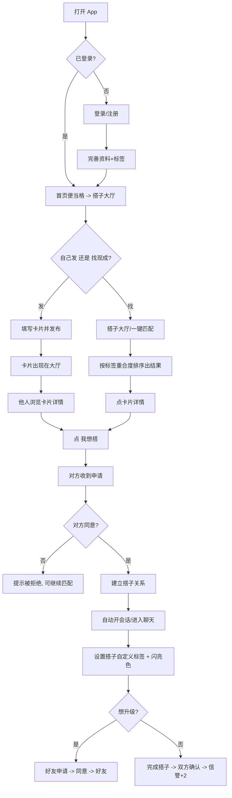
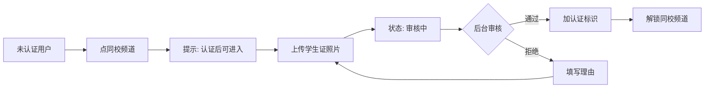
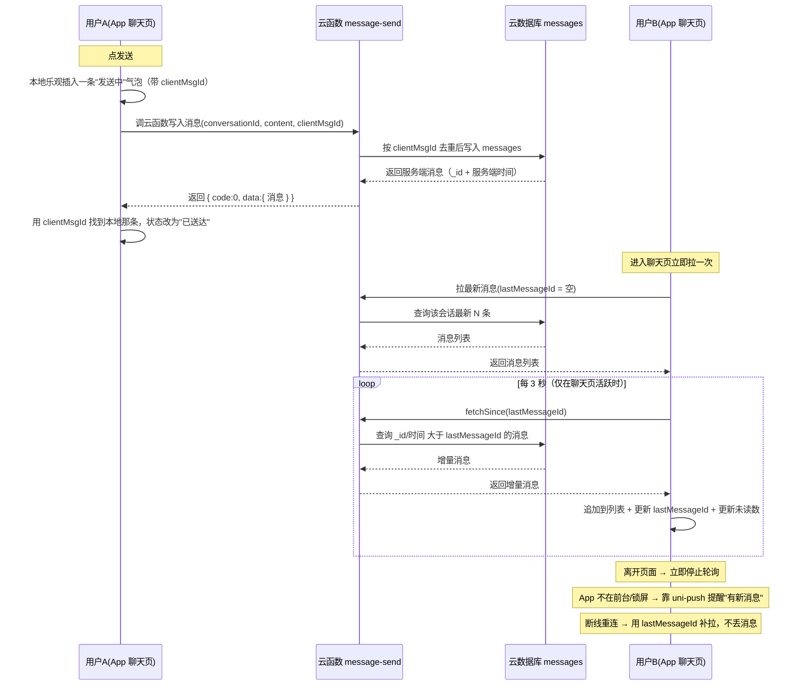
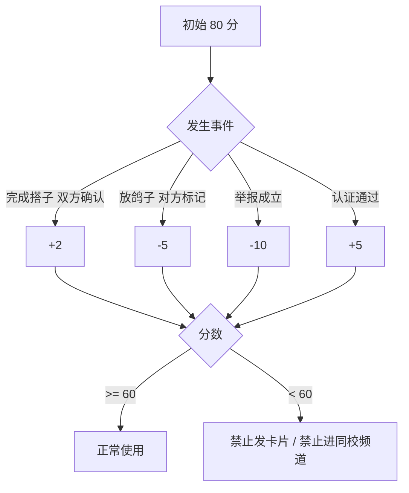

# 02 · 页面、流程与交互（v0.4）

> v0.4（2026-10-16）：发布入口从首页右下角悬浮按钮**搬进搭子大厅页内部**（顶部「发布搭子需求 ＋」大按钮，副文案「每天最多 5 条」）；**二级页面不再显示底部 tabBar**（只有 首页 / 同频圈 / 消息 / 我的 这 4 个一级页有）；同频圈频道由「同校 / 全国」改为「**同校 / 地区 / 发现**」三栏（发现 = 全国）；新增 P28 我的搭子（标签编辑）页（入口在「消息」页底部按钮）；**页面总数 27 → 28**。
> v0.3（2026-10-16）：底部 tab 改为 首页 / 同频圈 / 消息 / 我的（搭子大厅降级为首页子页面）；首页改为「便当格」布局并写明尺寸规则（§1.1）；新增 P26 同频圈页、P27 心理疏导（AI 会话）页；**页面总数 25 → 27**。
> v0.2（2026-10-16）：仅重写 §3.3 聊天链路为「消息表 + 3 秒轮询（传输层可替换为 WebSocket）」，其余未改动。
> 配套文档：[01-requirements.md](./01-requirements.md) · [03-database.md](./03-database.md) · [06-chat-transport.md](./06-chat-transport.md)
> 原则：页面少、路径短。**任何功能最多 3 次点击到达。**

---

## 1. 导航结构

底部 4 个 tab（**只有这 4 个一级页显示 tabBar**）：

```
[ 首页 ]   [ 同频圈 ]   [ 消息 ]   [ 我的 ]
```

- **首页**：便当格布局（尺寸规则见 §1.1）、每日百科顶部细条、我的搭子速览。
- **同频圈**：占的是原「大厅」tab 的位置（**暂定名，用户可随时改名**）；**同校 / 地区 / 发现** 三栏切换的日常内容流（P26，本期只做占位原型；「地区」= 同城·周边，「发现」= 全国）。
- **消息**：会话列表（含 AI 机器人固定会话）；底部有「我的搭子与标签 →」按钮，进 P28。
- **我的**：资料、认证状态、信誉分明细、称号墙、我的搭子 / 好友、设置。
- **发布**：**已取消原来悬在首页右下角的悬浮按钮**。发布入口只在**搭子大厅页内部**：大厅顶部一个「发布搭子需求 ＋」大按钮（副文案「每天最多 5 条」），点开同一个发布抽屉；大厅以外的页面不再有发布入口。
- **搭子大厅**：不再占底部 tab，降级为**首页下的子页面**（左上角返回）。
- **二级页面不显示 tabBar**：进入 搭子大厅、学习、健身、需求详情、匹配结果、学生认证、称号库、聊天、发一条日常、我的搭子 后底部 tabBar 不再出现，只靠左上角返回；回到 首页 / 同频圈 / 消息 / 我的 这 4 个一级页时才恢复。

### 1.1 首页「便当格」布局与尺寸规则（2026-10-16 新增）

便当格 = 卡片网格，但**板块尺寸刻意不统一**，越重要的块越大：

| 板块 | 尺寸规则 | 点击去向 |
|---|---|---|
| 搭子大厅 | **最大的一块**，独占首屏主位，是首页**唯一主入口**；内含 学习搭子 / 健身搭子 / 拍照·逛校园 / 竞赛搭子 四个方向 + 一键匹配 | P04 搭子大厅（子页面，左上角返回） |
| 学习 | **与健身一样大**：两个并排的半宽卡（各占一半宽） | P14 学习 & 番茄钟 |
| 健身 | **与学习一样大**：两个并排的半宽卡 | P12 健身与打卡 |
| 心理疏导 | 预留板块：**虚线边框的占位卡**（尺寸小于学习 / 健身） | P27 心理疏导（AI 对话） |
| 每日百科 | **顶部细条**（一行高） | P16 每日百科 |

> 原来首页那四个独立入口（找学习搭子 / 找健身搭子 / 拍照·逛校园 / 一键匹配）**全部并入搭子大厅**，不再各自占一块。

---

## 2. 页面清单（28 个）

| 编号 | 页面 | 入口 | 关键元素 | 主要数据 |
|---|---|---|---|---|
| P01 | 启动 / 登录页 | 冷启动未登录 | 手机号、密码、注册切换、协议勾选 | auth |
| P02 | 注册 / 完善资料 | 注册后强制一次 | 昵称、学校选择、年级、头像、兴趣标签（8–10 个可选） | users, user_tags |
| P03 | 首页 | tab 1 | **便当格布局**（尺寸规则见 §1.1）：搭子大厅最大块（唯一主入口）、学习 + 健身并排两个等大半宽卡、心理疏导虚线占位卡、每日百科顶部细条、我的搭子速览（最多 3 条） | cards, buddy, encyclopedia |
| P04 | 搭子大厅 | 首页「搭子大厅」大块（子页面，左上角返回；**无 tabBar**） | **顶部「发布搭子需求 ＋」大按钮（副文案「每天最多 5 条」）**、四个方向入口（学习搭子 / 健身搭子 / 拍照·逛校园 / 竞赛搭子）、一键匹配、范围切换（同校 / 附近 / 城市）、类型筛选（含**竞赛**）、标签筛选、卡片流、匹配按钮 | cards, tags |
| P05 | 发布卡片 | **搭子大厅页内的「发布搭子需求 ＋」按钮**（发布抽屉；首页右下角悬浮按钮已取消） | 类型、描述（200 字）、标签多选、时间、地点 | cards |
| P06 | 卡片详情 | 点列表卡片 | 发布者摘要（头像 / 学校 / 认证 / 信誉分 / 共同标签）、描述、时间地点、申请按钮、举报 | cards, users, applications |
| P07 | 匹配结果 | 大厅「一键匹配」 | 贴合度列表（百分比 + 共同标签）、换一批、去放宽条件 | match_result |
| P08 | 我的申请 / 收到的申请 | 卡片详情、消息红点 | 申请列表、同意 / 拒绝 | applications |
| P09 | 会话列表 | tab 3 | 头像、最后一条、未读数、搭子标签 | conversations, messages |
| P10 | 聊天页 | 点会话 | 消息气泡、图片、输入框、顶部搭子标签 / 自定义标签、举报 | messages |
| P11 | AI 机器人会话 | 消息页固定项 | 独立聊天框、介入开关、"非医疗建议"声明、快捷话题 | ai_messages |
| P12 | 健身与打卡 | 首页便当格·健身半宽卡 | 类型模板卡、我的计划、今日打卡 | fit_exercises, fit_plans, fit_plan_items, fit_sessions, fit_sets |
| P13 | 训练计划编辑 | 健身首页 | 动作增删改、组数次数、器械分类、引导教程、提醒时间 | fit_plan_items |
| P14 | 学习 & 番茄钟 | 首页便当格·学习半宽卡 | 学习搭子入口、番茄钟、资料列表、上传 | study_materials |
| P15 | 番茄钟 | 学习板块 | 1-180 分钟（预设 15/25/45/60 + 自定义）、开始暂停、离开页面继续计时、完成提醒、今日统计 | study_pomodoros |
| P16 | 每日百科 | 首页顶部细条 | 今日一条、收藏、往期 | encyclopedia |
| P17 | 我的 | tab 4 | 资料、认证状态、信誉分、称号墙、我的搭子、好友 | users, titles, buddy, friends |
| P18 | 资料编辑 | 我的 | 字段编辑、头像替换、标签编辑 | users |
| P19 | 认证申请 | 我的 / 拦截提示 | 上传学生证、状态、拒签理由 | verifications |
| P20 | 信誉明细 | 我的 | 分数曲线 + 每次加减分与原因 | credit_events |
| P21 | 称号墙 | 我的 | 已获得 / 未获得（置灰 + 条件文案）、佩戴 | titles, user_titles |
| P22 | 我的搭子 / 好友 | 我的 | 两个列表、自定义标签（限 8 字 + ＋搭子 + 推荐词 + 8 个预设闪亮色，完整编辑见 P28）、解除 / 删除 | buddy_relations, friendships |
| P23 | 举报页 | 卡片详情 / 聊天页 / 资料页 | 原因单选、补充说明、提交 | reports |
| P24 | 设置 | 我的 | 隐私政策、用户协议、注销账号、退出登录 | — |
| P25 | 管理后台（Web） | 单独地址 | 认证审核、举报处理、用户 / 百科 / 称号配置 | 全表 |
| P26 | 同频圈 | tab 2 | **同校 / 地区 / 发现** 三栏切换（并列在一行分段控件里；「地区」= 同城·周边，「发现」= 全国）、筛选项、图文 / 视频 / 吐槽 三种卡片形态、静态卡片流、发布入口提示、空态提示（**本期只做占位原型，无真实发布 / 上传 / 点赞 / 评论**） | posts, post_media |
| P27 | 心理疏导（AI 对话） | 首页「心理疏导」占位卡 | 情绪引导机器人聊天框、介入开关、"非医疗建议"声明、快捷话题（**预留板块：不做诊断 / 量表 / 危机干预话术**；复用 AI 会话） | conversations, ai_messages |
| P28 | 我的搭子（标签编辑） | **「消息」页底部按钮「我的搭子与标签 →」** | 关系列表（每段关系一个大号**闪亮标签** + 「改标签」按钮）、标签输入框（**限 8 字**）+ 「**＋搭子**」按钮、**推荐词**（考研战友 / 增肌搭子 / 自习搭子 / 拍照搭子 / 饭搭子 / 竞赛队友 / 夜跑搭子 / 雅思同桌）、**8 个预设闪亮色块**（闪耀黄 `#ffde00` / 熔岩橙 `#ff4d00` / 荧光粉 `#ff5fa2` / 霓虹紫 `#a855f7` / 电光青 `#22d3ee` / 薄荷绿 `#34d399` / 宝石蓝 `#3b82f6` / 香槟金 `#e9c46a`）、实时预览（**标签只在双方这一栏显示，可随时改**） | buddy_relations |

---

## 3. 核心流程

### 3.1 主链：找搭子 → 建立关系 → 聊天



### 3.2 学生认证



### 3.3 聊天链路（消息表 + 3 秒轮询，传输层可替换为 WebSocket）

> 设计细节见 [06-chat-transport.md](./06-chat-transport.md)。页面只调用 `createChatTransport()` 返回的接口，**不关心底层是轮询还是 WebSocket**。



### 3.4 信誉分规则



---

## 4. 交互约定（每个页面都要做到）

| 场景 | 约定 |
|---|---|
| 加载中 | 骨架屏或转圈，不能白屏 |
| 空列表 | 一句话说清 + 一个可点的下一步（例："还没有搭子，去大厅看看"） |
| 出错 | 一句话人话提示 + 重试按钮；技术错误不直接给用户看 |
| 断网 | 顶部横条"网络不可用"，恢复后自动重试上一次请求 |
| 提交类操作 | 按钮进入 loading 并禁用，防止重复提交 |
| 删除 / 解除 | 二次确认弹窗，说明后果 |
| 权限 | 相册 / 通知 / 定位被拒绝时，说明用途并给"去设置"入口 |

---

## 5. 权限与隐私（上架 / 答辩都会被问）

| 权限 | 用途 | 何时申请 |
|---|---|---|
| 相册 / 相机 | 头像、学生证、聊天图片、资料、同频圈发日常（P2） | 用户点上传时申请 |
| 通知 | 健身提醒、新消息 | 用户开启提醒时申请 |
| 定位 | "附近"范围（不用于判定学校，见待确认项 D2） | 用户切到"附近"时申请 |

隐私页必须写清：收集什么、为什么、保存多久、怎么删除；提供账号注销入口。
