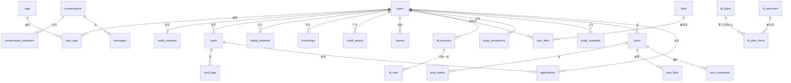

# 03 · 数据设计（uniCloud 云数据库 · 文档型）

> v0.5（2026-10-18）：§2.3 补「一对人 → N 条关系，但界面上必须只有一张卡」：`buddy_relations` 唯一性键改为 (`user_a_id`, `user_b_id`, `category`, `status`)，`conversations` 唯一性键改为 `user_pair_key`；并明确「按人合并」必须写在云函数里。集合总数不变，仍为 **32**。
> v0.4（2026-10-16）：`buddy_relations` 补 `label_a_color` / `label_b_color` 两个颜色字段（预设色 key，8 个闪亮色见 §2.3；前端用内联 `background-color` + 斜向白色高光实现反光质感）。**不新增集合**，集合总数不变，仍为 **32**（见 §2.3 与 §7）。
> v0.3（2026-10-16）：新增内容流（同频圈）4 个集合 `posts` / `post_media` / `post_likes` / `post_comments`（见 §2.8）；心理疏导**不新建表**，复用 `conversations(type='ai')` + `ai_messages` + `ai_usage_daily`（见 §2.4）。集合总数 **28 → 32**（原标题写的「26 个」漏算了 `admins` 与 `notifications`）。
> v0.2（2026-10-16）：整份改写为 uniCloud 云数据库版（文档型，基于 MongoDB）。表 → 集合，外键 → 存 `_id` 字符串。
> 配套文档：[01-requirements.md](./01-requirements.md) · [02-pages-and-flows.md](./02-pages-and-flows.md) · [04-tech-stack.md](./04-tech-stack.md) · [06-chat-transport.md](./06-chat-transport.md)
> 图例：🔑 主键 · 🔗 引用（存 `_id` 字符串）· ⚡ 需要索引

---

## 0. 先读懂 5 条约定的"为什么"

如果你以前只见过 MySQL 那种表格数据库，这一章是给你补的。**这 5 条后面的所有设计都建立在这里。**

| 约定 | 是什么 | 为什么这么定 |
|---|---|---|
| **集合 = 原来的表** | uniCloud 云数据库是**文档型**（基于 MongoDB），一行数据叫一个"文档"，一批文档放在一个"集合"里 | 集合 ≈ 表、文档 ≈ 行、字段 ≈ 列。你原来理解的表结构**几乎没有变**，只是不能再 join |
| **`_id` 是主键** | 每条文档创建时自动生成的字符串 id（你可以自己指定，也可以让它自动生成） | 云数据库自带，不用自己造 id 生成器；云函数之间传的就是这个字符串 |
| **引用用存 `_id`（字符串），不用外键** | 比如 `cards.owner_id` 里存的是 `users` 里那条文档的 `_id` 字符串 | 文档型数据库**没有外键约束，也没有 join**。好处是简单、快；坏处是"删了用户，他发的卡片不会自动消失"，所以**清理关联数据要在云函数里手动做** |
| **时间统一存毫秒时间戳（数字）** | 例如 `1760544000000`，字段名统一 `created_at` / `updated_at` | 二选一必须定死，否则排序和"查今天的数据"会出错。选毫秒时间戳的原因：① 数字比时间，天然可排序、可做范围查询；② 没有时区歧义（字符串如果格式不统一，`>= '2026-10-16'` 这种查询很容易漏数据）；③ 时间戳减一天就是 `-86400000`，算"最近 7 天"不用引库。**前端显示时再 `new Date(ts)` 转成本地时间** |
| **软删除** | 需要保留历史的文档加 `deleted_at`（0 或 null = 未删除） | 举报、订单、消息这类要留证据；但**列表查询必须都带上 `deleted_at` 条件**，否则"删了还看得见" |

> 补充：`_id` 用自动生成的字符串，不要用自增数字——云数据库高并发下没有可靠的"自增 id"，这是常见新手坑。

---

## 1. 实体关系（鸟瞰）



> 注意：这些连线**只是逻辑关系**（靠字段里存的 `_id` 体现），数据库**不会**帮你保证一致性。所以：**凡是"一次要改好几个集合"的操作，都写在一个云函数里，用事务包起来。**

---

## 2. 集合清单（37 个）

### 2.1 账号与资料（5 个）

| 集合 | 用途（一句话） | 关键字段 | 索引 ⚡ |
|---|---|---|---|
| `users` | 用户账号与资料 | `_id`、`uid`(string,8位数字，**对外唯一身份号**，搜人/加好友只用它)、`phone`(string,登录凭据)、`password_hash`(string,加盐哈希)、`nickname`(string,允许重名)、`user_no`(string,历史遗留字段，已不再生成)、`avatar_url`(string)、`school`(string)、`school_id`(string,可为空)、`grade`(string)、`gender`(string)、`bio`(string,≤50字)、`is_verified`(bool)、`credit_score`(int,默认80)、`current_title_id`(string,佩戴称号)、`status`(string: normal/banned)、`last_active_at`(number)、`real_name_verify_id`(string,为空)、`created_at`/`updated_at`(number) | **`uid`(唯一)**、`phone`(普通索引，仅登录/查重)、`school_id`、`credit_score`、`is_verified` |
| `verify_requests` | 学生认证申请（集合名以代码为准：31 个 `DB_*` 常量里没有 `verifications`，旧名已废） | `_id`、`user_id`、`card_image_url`(string)、`real_name_optional`(string,可选，最小化采集)、`status`(string: pending/approved/rejected)、`reject_reason`(string)、`reviewed_by`(string)、`reviewed_at`(number)、`created_at` | `user_id`、`status` |
| `tags` | 标签字典 | `_id`、`name`(string)、`category`(string: 作息/强度/性格/兴趣/偏好/科目)、`sort`(int)、`active`(bool) | `category`+`active` |
| `user_tags` | 用户选了哪些标签 | `_id`、`user_id`、`tag_id`、`weight`(number,默认1；性格类1.5)、`created_at` | `user_id`、`tag_id`、复合 `(user_id, tag_id)` 唯一 |

> 唯一性怎么办？文档型数据库**没有联合主键**。做法：建**唯一索引**（uniCloud 控制台里可以建），并且**云函数插入前先查一次**，双保险。

| 集合 | 用途（一句话） | 关键字段 | 索引 ⚡ |
|---|---|---|---|
| `admins` | 后台账号（与用户表分开，避免权限混用） | `_id`、`username`(string)、`password_hash`(string)、`role`(string: reviewer/super)、`created_at` | `username`(唯一) |

### 2.2 搭子与匹配

| 集合 | 用途（一句话） | 关键字段 | 索引 ⚡ |
|---|---|---|---|
| `cards` | 搭子卡片（一条"想找人一起做某件事"的需求） | `_id`、`owner_id`、`type`(string: study/fitness/photo/meal/sport/other)、`title`(string ≤30字)、`description`(string ≤200字)、`school_id`(string)、`city_code`(string)、`location_name`(string)、`latitude`/`longitude`(number,可空)、`start_time`/`end_time`(number,可空)、`expected_people`(int,默认1)、`status`(string: open/matched/closed/removed)、`created_at`/`updated_at` | `(status, type, created_at)`、`owner_id`、`school_id`、`city_code` |
| `card_tags` | 卡片带了哪些标签 | `_id`、`card_id`、`tag_id` | `card_id`、`tag_id` |
| `applications` | 申请（"我想搭"） | `_id`、`card_id`、`applicant_id`、`message`(string ≤100字)、`status`(string: pending/accepted/rejected/canceled)、`decided_at`(number)、`created_at` | `card_id`+`status`、`applicant_id` |
| `matches` | 匹配记录（答辩时能证明"算法真的在跑"） | `_id`、`user_id`、`card_id`、`score`(number 0–100)、`common_tag_count`(int)、`created_at` | `user_id`+`created_at` |

> 业务规则（要写进云函数校验，不是写进数据库）：
> - 同一 `(card_id, applicant_id)` 只能有一条 `pending`；
> - **发布者不能申请自己的卡片**；
> - 每人每天最多发 5 条卡片；
> - `credit_score < 60` 禁止发卡片。

### 2.3 关系：搭子 / 好友

| 集合 | 用途（一句话） | 关键字段 | 索引 ⚡ |
|---|---|---|---|
| `buddy_relations` | 搭子关系（**双向一条**记录） | `_id`、`user_a_id`、`user_b_id`（约定 `user_a_id < user_b_id`，避免重复）、`source_card_id`(可空)、`label_a`(string,A给这段关系起的标签，**≤8字**)、`label_b`(string)、`label_a_color`(string,预设色 **key**，如 `shine-yellow`；可空=用默认色)、`label_b_color`(string)、`done_a`(bool,A 已点「这次搭完了」)、`done_b`(bool,B 已点)、`done_count`(int,双方都点过的次数)、`last_done_at`(number,最近一次结算时间)、`status`(string: **pending / active / ended**，见下方「邀请期间的关系状态」)、`ended_by`(string)、`ended_at`(number)、`created_at` | `user_a_id`、`user_b_id`、复合 `(user_a_id, user_b_id)` 唯一、`status` |
| `friendships` | 好友关系（**双向一条**记录，建立后长期有效） | `_id`、`user_a_id`、`user_b_id`（**约定 `user_a_id < user_b_id`**，见下方唯一性键）、`created_at` | 复合 `(user_a_id, user_b_id)` 唯一 |
| `friend_unlinks` | 解除过好友的历史（**一对人一行**，只补「曾经是好友」这点痕迹） | `_id`、`user_a_id`、`user_b_id`（**约定 `user_a_id < user_b_id`**，与 `friendships` 同）、`removed_at`、`removed_by` |
| `friend_requests` | 好友申请（`source: buddy/search`） | `_id`、`from_user_id`、`to_user_id`、`source`(string: buddy/search)、`status`(string: **pending / accepted / rejected / canceled**)、`created_at`、`handled_at` | `to_user_id`+`status`、`from_user_id` |
| `user_remarks` | 用户备注（我给别人起的私有称呼，**一条 = 一个方向**） | `_id`、`owner_id`(string，谁起的)、`target_user_id`(string，给谁起的)、`remark`(string，**≤12 字**，按码点数)、`created_at`、`updated_at` | 复合 `(owner_id, target_user_id)` 唯一、`target_user_id` |

> **好友两表已落地（原为「只设计过、从未使用」，2026-10-19 补实际情况）**：
> - **写入方只有 `friend-request` 一个云函数**。`friend_requests`：`send` 建一条 `pending`、`accept` / `reject` / `cancel` 改状态；`friendships`：只有 `accept` 分支会写（先按 `(user_a_id, user_b_id)` 查，已存在就复用 `_id`，所以重复点同意不会建出第二条）。
> - **`status` 四个取值**：`pending`（待处理）、`accepted`（已同意）、`rejected`（被对方拒绝）、`canceled`（发起人自己撤回）。注意 `canceled` 是**单 l 美式拼写**，与 `accepted` / `rejected` 的双写不一致，是既有实现的既定取值，前端判断必须按 `canceled` 匹配。只有 `pending` 会被 `friend-request` 的 `list` 下发（历史申请对用户没有价值）。
> - **★ 成为好友时把双方 active 的搭子置 ended（新规则）**：`accept` 成功后，把两人之间所有 `status='active'` 的 `buddy_relations` 逐条改成 `status='ended'` + `ended_by='friend'` + `ended_at` + `update_time`。所以「已是好友」与「同一对人还有 active 搭子」不会同时成立——「我的搭子」页不会因为变成好友冒出一堆死条目。

> **`friend_unlinks` 为什么存在**：`friendships` 是「是好友就有一行，不是就没有」，解除好友直接删行、**历史不留**。于是 `is_friend:false` 同时代表「从来不是好友的搭子」和「当过好友又解除的」，前端无法区分（详见 `docs/28` §9）。这张表只补那点痕迹：一对人一行，先查再 `add`/`update`，重复解除只刷新 `removed_at`。三态判定优先级：`friendships` 有行 → `friend`；否则本表有行 → `unfriended`；都没有 → `none`。写入方只有 `friend-unlink` 与 `user-block`（拉黑会连带解除好友）两处，**各自独立 try/catch**，写失败不影响解除本身。
> - **★ 这条规则的回声（已修）**：`message-conversations` 拼 `buddy_tags` 只收 `status='active'` 的关系，一旦成为好友该行标签会**整行消失**，用户会误以为关系断了。所以该函数补了 `is_friend` 布尔字段（`friendships` 查不到就降级为 `false`，表没建也不影响消息列表返回），消息页据此显示「好友」徽标。
> - **好友关系的唯一性键是 `(user_a_id, user_b_id)`，且一律 `user_a_id < user_b_id`**（字符串比较，落库前用 `orderPair()` 排序）。不这么约定，同一对好友会存出两条镜像记录，好友列表里同一个人出现两次。查询「我参与的好友关系」必须分两次查（我作为 `user_a_id` / 我作为 `user_b_id`），**不要用 `or`**：`or` 里一旦把 a / b 写反，查出来的是别人之间的关系。

> **★★ 搭子标签是「私有备注」（2026-10-18 定案，不可回退）**：`label_a` 只属于 `user_a`、`label_b` 只属于 `user_b`，**各写各的、互相不可见**。用户原话：「自己只能看到自己给对面起的搭子标签，就类似于备注一样，但是不要与用户备注混为一谈」。
> - 写：任何入口（`card-apply` 同意申请后接受方自命名、`buddy-tag` 改标签、`buddy-invite` 接受邀请时自命名）**只允许写自己那一侧**。谁也不能替对方写备注。
> - 读：任何云函数**不得把对方那一侧的 `label_*` 下发给当前用户**。已落实在 `buddy-list`（不再返回 `his_label` / `his_label_color`）、`user-profile`（`relations[]` 不再返回 `his_label`）、`buddy-invite`（`accept` 不回传发起方标签；`list` 仅在 `box='out'` 时回显自己写的标签）、`message-conversations`（只取我这一侧的 label 拼 `buddy_tags`）。
> - 展示：界面上的「你叫他」「他叫你」两行已删除。邀请卡片、通知文案也只按**类型**说「想和你做学习搭子」，不暴露对方写的名字。
> - 与「用户备注」的区别：搭子标签绑定的是**一段关系**（同一对人在不同 category 下可以各有标签），用户备注绑定的是**一个人**；两者字段、表、生命周期都不同，**不要合并**。
>
> **★★ 一对人 → N 条关系，但界面上必须只有一张卡（2026-10-18 定案）**：
> - 数据层：`buddy_relations` 的唯一性键是 **(`user_a_id`, `user_b_id`, `category`)**，且该组合下同时最多只有一条「未结束」的关系（`status` ∈ {`pending`, `active`}），不是 (`user_a_id`, `user_b_id`)。同一对人在 `study` / `fitness` / `photo` 下可以同时各有一段 active 关系，各自有独立的 `label_a` / `label_b`。
>   **2026-10-21 更正**：原来这里写的是 `status='active'`。引入 `pending` 后，若唯一性只认 active，同一 `category` 下会同时躺着 pending + active 两条（accept 找不到那条 pending 就会另建），所以 `ensureRelation()` 的判重条件已改为 `status: dbCmd.in(['active','pending'])`。
> - 会话层：`conversations` 的唯一性键是 **`user_pair_key`**（两个 `_id` 排序后 `A|B` 拼接），**不是** `buddy_relation_id`。一对人全局只有一条 direct 会话，它同时服务于这个人名下的所有关系。`buddy_relation_id` 字段保留但**不参与判重**（老数据仍可能带着它，供兼容反查）。
> - 展示层：任何"我的搭子"类列表**必须按人合并**，一条记录 = 一个人，其 `tags[]` 带上他名下全部关系产生的标签。**合并写在云函数里**（`buddy-list` 返回的就是按人合并后的结构），前端不再自己判断——否则每多一个读这份数据的页面就要重新实现一次合并，迟早漏一处（消息页、聊天页、我的搭子页都栽过这个坑）。
> - 反例（已修）：`pages/buddy/buddy.vue` 曾直接 `v-for` 关系行，同一个人有几段关系就渲染几张卡；列表 `:key` 也不能用 `relation_id`，要用 `other_user_id`（一条卡 = 一个人）。
>
> **★ 邀请期间的关系状态（2026-10-21 修，`pending` 是新增取值）**：
> - **`status` 现在三个取值**：`pending`（邀请已发出、对方还没回应）、`active`（对方同意了，关系成立）、`ended`（解除 / 被好友关系收掉 / 被清理）。
> - **写入时序**：`buddy-invite` 的 `invite` 分支建一条 `status:'pending'` 的关系（**不是 active**），并把发起方自己那侧的 `label_a`/`label_b` 当场写进去；对方点同意时 `accept` 分支把同一条关系 `patch.status = 'active'`；拒绝 / 撤回时 `dropPendingRelation()` 把它改成 `ended`。
> - **为什么必须是 pending**：`user-profile` / `buddy-list` / `buddy-tag` / `message-conversations` **全都只查 `status:'active'`**。旧实现邀请时就写 active，于是邀请还没被同意，对方主页已经显示「你们之间的搭子」+ 类别名 —— 这是「点邀请后对方直接出现搭子标签」的成因。
> - **判重必须同时看 pending 和 active**：`ensureRelation()` 的判重条件是 `status: dbCmd.in(['active','pending'])`。只查 active 的话，`accept` 会找不到那条 pending 而另建一条 active，同一 `category` 下躺着两条，标签落在错的那条上。
> - **`dropPendingRelation(inv, now, reason)`**：先按 `{source_invite_id, status:'pending'}` 精确定位，找不到再退化为按 `{user_a_id, user_b_id, category, status:'pending'}`。**只动 pending，绝不碰 active** —— active 可能来自别的邀请或卡片申请。
> - **`ended_by` 的取值**：`friend`（成为好友时收掉，见上）、`rejected`（对方拒绝）、`cancelled`（发起人撤回）、`repair`（历史脏数据清理）、以及 `buddy-unlink` 解除搭子时写的值。
> - **历史脏数据清理**：`buddy-invite` 提供 `action:'repair'`（不带任何参数直接运行也会走）：扫 `{source_type:'invite', status:'active'}` 的关系，逐条查它 `source_invite_id` 指向的邀请，邀请状态**不是 `accepted`** 的说明这段关系从没被同意过，改成 `{status:'ended', ended_by:'repair'}`。真正成立的搭子（邀请是 accepted）一条不动。

> **搭子自定义标签的颜色（2026-10-16 新增）**：`label_a_color` / `label_b_color` 各存一个**预设色 key（字符串）**，**不存 hex**。理由：① 颜色是**封闭的 8 选 1**，不是自由取色盘——存 key 让前端只认一份色表、换色（改 hex）不用回刷历史数据，也免得用户从外部粘贴任意色值把界面搞脏；② 校验简单，`enum` 就能挡住非法值（存 hex 则要写格式正则，还挡不住"合法但不属于这 8 个"的颜色）；③ 与既有风格一致——本项目所有"枚举型"字段（`type` / `status` / `kind` / `rarity`）都是存英文 key，中文名与 hex 由前端色表负责映射。
> 预设色就是 **8 个「带反光质感的闪亮色」**：`shine-yellow` 闪耀黄 `#ffde00`、`shine-orange` 熔岩橙 `#ff4d00`、`shine-rose` 荧光粉 `#ff5fa2`、`shine-violet` 霓虹紫 `#a855f7`、`shine-cyan` 电光青 `#22d3ee`、`shine-mint` 薄荷绿 `#34d399`、`shine-blue` 宝石蓝 `#3b82f6`、`shine-gold` 香槟金 `#e9c46a`。**反光质感由前端实现**：色块与标签用内联 `background-color` 上底色，再叠一道**斜向白色高光**（如 `linear-gradient(115deg, rgba(255,255,255,.55) 0%, rgba(255,255,255,0) 45%)`）；这层高光是纯展示，**不入库**，所以数据库只存颜色 key。

> **★ `user_remarks` 用户备注（2026-10-21 新增，与搭子标签是两张表）**：
> - **一条记录只代表一个方向**：`owner_id` 是起备注的人，`target_user_id` 是被起备注的人。A 叫 B「老张」不会让 B 那边看到「老张」，B 对 A 的称呼是另一条记录。所以**不存在双向共用一条**，这与 `buddy_relations` / `friendships` 的 `user_a_id < user_b_id` 约定完全不同，不要照抄那套。
> - **唯一性键是 `(owner_id, target_user_id)`**，写入前不必排序（两个字段语义不同，不能互换）。重复设置走 **upsert**：先 `get` 查有无旧行再决定 `add` 还是 `update`，**不能靠 `update` 返回的 `updated` 条数判断** —— 把备注改成和原来一样的值时 `updated=0`，会被误判成没有旧行，于是再 `add` 一条，同一对人出现两条备注。
> - **删除语义**：`remark` 传空串表示**删除这条备注**（`where(cond).remove()` 删整行），不是存一个空字符串。查询侧一律 `remarkMap[id] || ''`，没有记录和空备注在界面上等价。
> - **长度按码点数算，不是 `String.length`**：`charLen()` 用 `Array.from(s).length`，所以一个 emoji 算 1 个字。上限 `REMARK_MAX = 12`。用 `.length` 会让含 emoji 的备注被误判超长。
> - **展示规则（2026-10-21 定）**：有备注时，昵称位置显示**备注**，正下方用灰色小字显示「用户名：<真实昵称>」；没有备注时只显示真实昵称、不显示小字行。头像首字**始终取真实昵称**，不被备注改写（头像代表这个人本身）。
> - **读方（4 处，各自独立 try/catch，表不存在就静默降级空串）**：`user-profile`（出 `my_remark`）、`buddy-list`、`friend-list`、`message-conversations`（各出 `remark` 字段）。写方只有 `user-remark` 一个云函数（`set` / `map` 两个 action，`map` 供批量反查，上限 `MAP_MAX = 50`）。
> - **与 `buddy_tag` 的分工**：`buddy_tag` 是「这段关系叫什么」（绑定 `buddy_relations`，成为好友后会被 `status='ended'` 收掉），`remark` 是「这个人叫什么」（绑定人，一直存在）。**两者不合并、不同表、不同生命周期。**
### 2.4 聊天

| 集合 | 用途（一句话） | 关键字段 | 索引 ⚡ |
|---|---|---|---|
| `conversations` | 会话 | `_id`、`type`(string: direct/ai)、`buddy_relation_id`(可空，用于显示搭子标签)、`last_message_id`(string,排序用)、`last_message_at`(number,排序用)、`created_at`/`updated_at` | `last_message_at`、`type` |
| `conversation_members` | 会话成员（谁在这个会话里、未读数、每人一份的会话设置） | `_id`、`conversation_id`、`user_id`、`unread_count`(int,默认0)、`last_read_message_id`(string,已读游标)、`pinned`(bool,默认false)、`muted`(bool,默认false)、`cleared_at`(number,默认0) | 复合 `(conversation_id, user_id)` 唯一、`(user_id, unread_count)` |
| `messages` | 消息 | `_id`、`conversation_id`、`sender_id`、`type`(string: text/image/voice/system)、`content`(string,文本或图片 URL)、`client_msg_id`(string,客户端生成，**去重与重发用**)、`duration`(int,仅 voice：秒数 1–60)、`recalled`(bool,默认false)、`recalled_at`(number,默认0)、`recalled_by`(string)、`created_at`(number) | `(conversation_id, created_at)`、复合 `(conversation_id, client_msg_id)` 唯一 |
| `ai_messages` | AI 机器人会话消息（**与真人消息分开存**） | `_id`、`user_id`、`role`(string: user/assistant)、`content`(string)、`tokens`(int,统计用量)、`created_at` | `(user_id, created_at)` |
| `ai_usage_daily` | AI 每日用量（做额度的依据） | `_id`、`user_id`、`date_key`(string,形如 `2026-10-16`，用服务器时间生成)、`count`(int)、`updated_at` | 复合 `(user_id, date_key)` 唯一、`date_key`（全局日额度要统计当天所有记录） |

> 为什么 AI 消息要和真人消息分开？① 计额度和审计方便；② AI 的历史将来可以单独清理；③ 万一 AI 接口出问题，不会污染真实聊天记录。
> **心理疏导（情绪引导机器人）不新建表**：直接复用 `conversations(type='ai')`（每个用户一条固定 AI 会话，与消息页的固定项是同一个）+ `ai_messages` + `ai_usage_daily`（额度规则见 §4.5）。本期心理疏导只保留首页入口与占位、不实际调用 AI，所以这 3 个集合暂时只放演示数据。

> **`conversation_members` 的三个新字段都是「每人一份」**：`pinned` / `muted` / `cleared_at` 只作用在我这一行，对方的行不受影响。所以「置顶」「免打扰」「清空记录」都必须是 `where({conversation_id, user_id: me._id}).update(...)` —— 少写 `user_id` 会把对方也一起置顶/清空。
>
> **`cleared_at` 不是「删除」**：它只记一个时间点，消息一条都不删。`message-list` 与 `message-search` 都按 `created_at > cleared_at` 过滤，`message-conversations` 里「清空之后没有新消息」的会话整行不返回；一旦对方发来新消息（`last_at > cleared_at`），会话会自动重新出现在列表里。
>
> **撤回不删数据**：`recalled=true` 只打标记，`content` 原文仍留在库里（举报与审核要用）。`message-list` 下发时把 `content` 换成空串，前端按 `recalled` 渲染成「你撤回了一条消息」。
>
> **`type` 新增 `voice`**：语音消息的 `content` 仍是云存储 fileID（与图片同构），另带 `duration` 秒数。文字/图片消息的文档形态与改造前完全一致，`duration` 只在语音上写。

### 2.4.1 `user_blocks`（黑名单，单向）

| 集合 | 用途（一句话） | 关键字段 | 索引 ⚡ |
|---|---|---|---|
| `user_blocks` | 黑名单（**单向**：我拉黑他 ≠ 他拉黑我） | `_id`、`owner_id`(string 🔗 拉黑发起人 = 我)、`target_id`(string 🔗 被拉黑的人)、`created_at`(number) | 复合 `(owner_id, target_id)` 唯一、`owner_id`、`target_id` |

> **为什么要三个索引**：这张表被三个方向读 —— 「我拉黑了谁」（`owner_id`，会话列表每次都要）、「谁拉黑了我」（`target_id`，`message-send` 每条消息都要）、「我拉黑他没有」（`owner_id + target_id` 精确查）。少任何一个都有一次查询退化成全表扫。
>
> **拉黑的连锁动作**（`user-block` 的 add 分支，两段各自独立 try/catch）：① 删掉 `friendships` 里这一对的行；② 把两个方向上 `pending` 的 `friend_requests` 置成 `canceled`。两段失败都不影响拉黑本身生效。
>
> **单向彻底静默的三道闸**：`message-send` 双向拦截（他拉黑我 → 我发不出去；我拉黑他 → 我也发不出去）、`message-conversations` 剔掉我拉黑的会话整行、`user-profile` 的 `can_invite` 一律 false。

### 2.5 信誉、举报、称号

| 集合 | 用途（一句话） | 关键字段 | 索引 ⚡ |
|---|---|---|---|
| `credit_events` | 信誉流水（**分数的唯一真相**） | `_id`、`user_id`、`delta`(int: +2/−5/−10/+5)、`reason_code`(string: **buddy_done / no_show / report_upheld / verify_pass / admin_adjust**，与 `credit_rules.code` 对应)、`reason_text`(string,写入时的文案快照)、`ref_id`(string,关联的搭子关系/认证申请/举报 id，可空)、`score_after`(int,变更后分数，便于画曲线)、`created_at` | `(user_id, created_at 降序)` |
| `credit_rules` | 信誉规则表（**分值不许写死在代码里**） | `_id`、`code`(string,唯一，与 `credit_events.reason_code` 对应)、`delta`(int,分值)、`text`(string,给用户看的人话)、`active`(bool,false=停用并回落到代码内置默认值)、`created_at` | `code` 唯一 |
| `reports` | 举报 | `_id`、`reporter_id`、`target_type`(string: user/card/message/material)、`target_id`(string)、`reason`(string: harassment/fake/ad/other)、`detail`(string)、`status`(string: pending/upheld/dismissed)、`handled_by`(string)、`handled_at`(number)、`created_at` | `(status, created_at)`、`(reporter_id, target_type, target_id)` 唯一 |
| `titles` | 称号库（**表可以是空的**，代码内置 3 条兜底） | `_id`、`code`(string,唯一，如 `profile_complete`)、`name`(string)、`desc`(string)、`rarity`(string: common/rare/epic)、`condition_type`(string: **profile / verify / buddy**，本轮只认这三种)、`condition_value`(int,可空)、`condition_text`(string,给用户看的解锁条件)、`icon_url`(string)、`active`(bool)、`sort`(int)、`created_at`(long) | `code` **唯一** |
| `user_titles` | 用户获得了哪些称号 | `_id`、`user_id`、`title_id`(**存的是 `titles.code` 字符串，不是 `titles._id`**——表空也能工作)、`obtained_at`(long)、`is_equipped`(bool,同时只有1个为true) | 复合 `(user_id, title_id)` 唯一、`user_id` |

### 2.6 健身 / 学习 / 百科

| 集合 | 用途（一句话） | 关键字段 | 索引 ⚡ |
|---|---|---|---|
| `fit_exercises` | 动作库（66 条内置） | `_id`、`name`(string)、`alias`(string[])、`muscle`(string: chest/back/shoulder/biceps/triceps/legs/glutes/core/forearm/calf/cardio/stretch)、`muscle_sub`(string,具体部位)、`equipment`(string: barbell/dumbbell/machine/cable/bodyweight/kettlebell/band/other)、`mechanics`(string: compound/isolation)、`force`(string: push/pull/static)、`level`(string: beginner/intermediate/advanced)、`default_sets`(int)、`default_reps`(string,如 `8-12`)、`default_rest`(int,秒)、`secondary`(string[],协同肌群)、`tip`(string,要点)、`sort`(int)、`active`(bool) | `(active, muscle)`、`(active, equipment)` |
| `fit_plans` | 训练计划（5 套官方模板，表结构与个人计划共用） | `_id`、`user_id`(string,官方模板为空)、`name`(string)、`goal`(string: muscle/fat_loss/shaping/stretch)、`source`(string: template/custom)、`day_count`(int,这套计划几天一循环)、`sort`(int)、`active`(bool)、`created_at` | `(active, sort)` |
| `fit_plan_items` | 计划里「第几天练哪个动作」 | `_id`、`plan_id`、`day_index`(int 1-31)、`exercise_id`(指向 `fit_exercises._id`)、`exercise_name`(string,冗余)、`sets`(int)、`reps`(string)、`rest`(int,秒)、`sort`(int) | `(plan_id, day_index, sort)` |
| `fit_sessions` | 一次训练（**打卡的唯一真相**） | `_id`、`user_id`、`plan_id`、`plan_name`(string,冗余，计划改名后历史不变)、`plan_day_index`(int)、`log_date`(string,形如 `2026-10-16`)、`started_at`、`finished_at`、`duration_sec`(int)、`total_sets`(int,不含热身)、`total_volume`(number,kg)、`muscles`(string[],练到的部位)、`note`(string)、`status`(string: ongoing/done/abandoned)、`updated_at` | `(user_id, status)`、`(user_id, log_date)` |
| `fit_sets` | 一次训练里的**每一组** | `_id`、`session_id`、`user_id`、`exercise_id`、`exercise_name`(string,冗余)、`muscle`(string,冗余)、`set_index`(int)、`weight`(number,kg,支持 0-500)、`reps`(int,1-200)、`rest_sec`(int)、`is_warmup`(bool)、`is_pr`(bool,**写入时判定并落库**)、`est_1rm`(number,估算 1RM)、`done_at`、`created_at` | `(session_id, exercise_id)`、`(user_id, exercise_id, weight)` |
| `study_pomodoros` | 番茄钟记录 | `_id`、`user_id`、`minutes`(int 1-180，**记的是设定时长**，不是实际用了多久)、`started_at`、`finished_at`、`completed`(bool,false=中途放弃)、`subject`(string ≤20 字)、`log_date`(string,按 `finished_at` 算) | `(user_id, log_date)` |
| `study_materials` | 资料共享 | `_id`、`user_id`、`title`(string)、`course`(string)、`description`(string)、`file_url`(string)、`file_type`(string)、`file_size`(int,≤20MB)、`status`(string: pending/approved/rejected)、`download_count`(int)、`created_at` | `(status, created_at)`、`user_id` |
| `encyclopedia` | 每日百科（**空表也能跑**，首页显示空态） | `_id`、`title`(string)、`content`(string)、`category`(string: study/health/life/campus)、`publish_date`(string,形如 `2026-10-16`；**演示数据留空串**，靠「最近一条」回落)、`active`(bool)、`created_at`(long) | `publish_date` **唯一** |

> `log_date` / `publish_date` / `date_key` 这类"按天"的字段用 `YYYY-MM-DD` 字符串而不是时间戳，因为要能按天分组和比较（时间戳每次都不一样，做不到）。这是 03 文档里唯一不按毫秒时间戳存的时间字段，属于刻意例外。
>
> **百科取数规则（2026-10-22 落地）**：`encyclopedia-daily` 先按 `{publish_date: 今天, active: true}` 精确查；查不到回落按 `publish_date desc, created_at desc` 取最近一条已发布的；都没有返回 `item: null`。**「今天」按北京时间算**——服务器是 UTC，直接取 UTC 日期会在早上 8 点前算成昨天。
>
> **唯一索引只加在真正"一天一条"的地方**（`encyclopedia.publish_date`）。`fit_sessions.log_date` 与 `study_pomodoros.log_date` **故意不加唯一约束** —— 一天练两次、记多个番茄都是正常的，约束死反而会挡住用户。

### 2.7 运营

| 集合 | 用途（一句话） | 关键字段 | 索引 ⚡ |
|---|---|---|---|
| `notifications` | 站内通知（先只做列表，不做推送） | `_id`、`user_id`、`type`(string)、`title`(string)、`content`(string)、`ref_id`(string)、`is_read`(bool)、`created_at` | `(user_id, is_read)` |

### 2.8 内容流（同频圈，P2 / 预留；本期只读占位数据）

> **口径澄清（2026-10-31）**：本节 4 个集合仍是 **P2 预留，没有任何云函数读写它们**。同频圈的列表页现在读的是 `cards` 集合的搭子卡片流（调 `card-list`），**不是** `posts`。别看到「同频圈能看到内容」就以为 `posts` 已启用——见 `docs/28` §10。

| 集合 | 用途（一句话） | 关键字段 | 索引 ⚡ |
|---|---|---|---|
| `posts` | 日常内容帖（同频圈里的"图文 / 视频 / 吐槽"卡片） | `_id`、`author_id`、`scope`(string: school/district/national，**同校 / 地区 / 发现 三栏切换靠它**；`district`=同城·周边，`national`=发现=全国)、`kind`(string: image/video/text，**图文 / 视频 / 吐槽 三种形态**；吐槽 = text)、`content`(string ≤500字)、`school_id`(string，冗余作者学校，同校流筛选用)、`city_code`(string，冗余作者城市，**地区流筛选用**)、`media_count`(int,冗余，卡片渲染用)、`cover_url`(string,封面)、`like_count`/`comment_count`(int,冗余计数)、`status`(string: pending/approved/rejected/removed，**审核状态**)、`reject_reason`(string)、`reviewed_by`(string)、`reviewed_at`(number)、`deleted_at`(number,软删除)、`created_at`/`updated_at` | `(status, scope, created_at)`、`(status, kind, created_at)`、`author_id`、`school_id`、`city_code` |
| `post_media` | 帖子里的图片 / 视频 | `_id`、`post_id`、`type`(string: image/video)、`url`(string,云存储 URL)、`thumb_url`(string,视频封面)、`width`/`height`(int)、`duration`(int,视频秒数，图片为 0)、`file_size`(int,字节，单个 ≤20MB)、`sort`(int)、`created_at` | 复合 `(post_id, sort)` |
| `post_likes` | 点赞 | `_id`、`post_id`、`user_id`、`created_at` | 复合 `(post_id, user_id)` 唯一、`user_id` |
| `post_comments` | 评论 / 吐槽回复 | `_id`、`post_id`、`author_id`、`content`(string ≤200字)、`reply_to_comment_id`(string,可空)、`status`(string: approved/removed)、`deleted_at`(number)、`created_at` | `(post_id, created_at)`、`author_id` |

> 业务规则（同 §2.2 的写法，都在云函数里校验，不是写进数据库）：
> - 本期**只做占位原型**：只有静态演示数据 + 客户端只读，发布 / 上传 / 点赞 / 评论的云函数排到 P2；
> - 帖子审核：`pending` → `approved`（公开可见）/ `rejected`（驳回，必填 `reject_reason`）；违规走 `removed`，不物理删除；
> - `scope='school'` 的帖子只在同校流出现（靠冗余的 `school_id` 过滤）；`scope='district'` 只在地区流出现（靠冗余的 `city_code` 过滤）；`scope='national'` 就是「发现」频道（全国）；未认证用户没有 `school_id`，只给看地区与发现；
> - `like_count` / `comment_count` 由点赞 / 评论的云函数在**同一事务**里 +1 / −1，不靠实时聚合。

---

## 3. DB Schema 详解（这是 uniCloud 最该学的一块）

### 3.1 DB Schema 是干什么的

在 uniCloud 里，每个集合可以配一份 **DB Schema**（一份 JSON）。它同时干三件事：

1. **定义字段类型与必填**（`bsonType` / `required`）——相当于 MySQL 的建表约束，帮你挡住写错的脏数据；
2. **定义谁能读写哪几行**（`permission.read/create/update/delete`）——相当于后端的接口鉴权；
3. **决定客户端能不能直接读这个集合**（`"client": true` 才允许客户端 db 直接读）。

> **最关键的一句**：权限表达式能挡"哪些字段能读"，但**挡不住"哪几行能读"**（读操作拿不到具体文档的上下文）。所以：**写操作我们全部交给云函数**，客户端只读公开数据；**所有"这行数据是不是你的"的校验，必须在云函数里再做一遍**。

### 3.2 `users` 集合 DB Schema

```json
{
  "collection": "users",
  "version": "1.0",
  "description": "用户账号与资料。**写操作一律走云函数**（注册、改资料、改信誉分、封禁）。",
  "client": true,
  "db": {
    "bsonType": "object",
    "required": ["phone", "password_hash", "nickname", "created_at"],
    "permission": {
      "read": true,
      "create": false,
      "update": false,
      "delete": false
    },
    "properties": {
      "_id": { "description": "主键，自动生成" },
      "phone": { "bsonType": "string", "description": "手机号，唯一，登录用" },
      "password_hash": {
        "bsonType": "string",
        "description": "加盐哈希后的密码。绝不存明文。不要放进读白名单",
        "permission": { "read": false }
      },
      "nickname": { "bsonType": "string", "minLength": 1, "maxLength": 20 },
      "user_no": { "bsonType": "string", "description": "展示用用户号，如 U100238，方便搜人加好友" },
      "avatar_url": { "bsonType": "string" },
      "school": { "bsonType": "string" },
      "school_id": { "bsonType": "string", "description": "学校字典 id，可为空；同校筛选靠它" },
      "grade": { "bsonType": "string" },
      "gender": { "bsonType": "string", "enum": ["male", "female", "secret"] },
      "bio": { "bsonType": "string", "maxLength": 50, "description": "一句话简介，≤50 字" },
      "is_verified": { "bsonType": "bool", "description": "学生认证是否通过；卡片标识、同校频道都看它" },
      "credit_score": {
        "bsonType": "int",
        "minimum": 0,
        "maximum": 100,
        "description": "信誉分。默认 80；只能由云函数按 credit_events 流水推导后写入"
      },
      "current_title_id": { "bsonType": "string", "description": "当前佩戴的称号 _id，可为空" },
      "status": { "bsonType": "string", "enum": ["normal", "banned"] },
      "last_active_at": { "bsonType": "number", "description": "最近活跃时间（毫秒时间戳）" },
      "created_at": { "bsonType": "number", "description": "创建时间（毫秒时间戳）" },
      "updated_at": { "bsonType": "number" }
    }
  }
}
```

**逐段解释**：

| 这一段 | 在做什么 | 为什么 |
|---|---|---|
| `"client": true` | 允许客户端直接读这个集合 | 需要展示他人资料（卡片详情页要显示发布者头像/昵称/信誉分） |
| `"read": true` | 任何登录用户都能读 | 资料本来就是公开的；真正的敏感字段用 `.field()` 白名单挡 |
| `"create"/"update"/"delete": false` | **谁都不能从客户端直接写** | 这是本项目的总原则。注册要查手机号是否重复、要算哈希；改信誉分要写流水——**这些校验只能放云函数**，一旦放开客户端写，规则就形同虚设 |
| `password_hash` 的 `"permission": {"read": false}` | 连读都不给 | 双保险：即便哪天 read 白名单写漏了，哈希也读不到 |
| `bsonType` / `required` | 类型与必填校验 | 挡脏数据。注意 `credit_score` 用 `int` 且限 0–100，防止出现 `"80"` 这种字符串分数导致 `>= 60` 判断出错 |
| 毫秒时间戳的 `"bsonType": "number"` | 统一时间类型 | 前面 §0 定好的：数字，能排序能比大小，没有时区歧义 |

> **读白名单怎么写**：想精确控制客户端能读哪些字段，在云函数里查询时用 `.field()`，例如
> `db.collection('users').field({ nickname: true, avatar_url: true, school: true, credit_score: true }).get()`
> 这样即使 schema 的 `read` 是 `true`，返回里也不会带 `phone` / `password_hash`。**能不带就别带。**

### 3.3 `cards` 集合 DB Schema

```json
{
  "collection": "cards",
  "version": "1.0",
  "description": "搭子卡片。发布/编辑/下架走云函数；客户端只读。",
  "client": true,
  "db": {
    "bsonType": "object",
    "required": ["owner_id", "type", "title", "description", "school_id", "status", "created_at"],
    "permission": {
      "read": true,
      "create": false,
      "update": false,
      "delete": false
    },
    "properties": {
      "_id": { "description": "主键" },
      "owner_id": { "bsonType": "string", "description": "发布者 users._id（存字符串，不是外键）" },
      "type": {
        "bsonType": "string",
        "enum": ["study", "fitness", "photo", "meal", "sport", "other"],
        "description": "需求类型；匹配算法要按它做硬过滤"
      },
      "title": { "bsonType": "string", "minLength": 1, "maxLength": 30 },
      "description": { "bsonType": "string", "minLength": 1, "maxLength": 200 },
      "school_id": { "bsonType": "string", "description": "冗余发布者学校，用于同校筛选，避免每次都回查 users" },
      "city_code": { "bsonType": "string", "description": "城市编码，地区范围筛选用" },
      "location_name": { "bsonType": "string" },
      "latitude": { "bsonType": "number", "description": "可为空；附近排序用" },
      "longitude": { "bsonType": "number" },
      "start_time": { "bsonType": "number", "description": "可为空；按类型选填（毫秒时间戳）" },
      "end_time": { "bsonType": "number" },
      "expected_people": { "bsonType": "int", "minimum": 1, "maximum": 10, "description": "想找几个人，默认 1；MVP 只做 1 对 1" },
      "status": {
        "bsonType": "string",
        "enum": ["open", "matched", "closed", "removed"],
        "description": "open=大厅可见；removed=被下架/违规，不物理删除"
      },
      "created_at": { "bsonType": "number" },
      "updated_at": { "bsonType": "number" }
    }
  }
}
```

**逐段解释**：

| 这一段 | 在做什么 | 为什么 |
|---|---|---|
| `status` 用 `removed` 而不是删文档 | 软删除 | 举报处理、答辩复盘都要能查到这张卡片；物理删除就没了 |
| `school_id` 冗余存一份 | 发布卡片时把发布者的学校抄一份进来 | 文档型数据库不能 join，大厅筛选"同校"如果每次都回查 `users`，一张卡片列表要查几十次。**冗余一个字段换取查询次数，这是文档型的常规做法** |
| `create: false` | 发布卡片必须走云函数 | 云函数里要一起校验：每天 ≤5 条、信誉分 ≥60、`card_tags` 要同时写、`school_id` 要从当前用户取（不能让客户端随便传别人的学校）——**客户端直写绕不过这些** |
| `expected_people` 限 1–10 | 类型校验 | 防止出现 0 人或 999 人这种脏数据 |

### 3.4 `conversations` 集合 DB Schema

```json
{
  "collection": "conversations",
  "version": "1.0",
  "description": "会话。创建走云函数（如同意申请时自动开会话）；客户端只读。",
  "client": true,
  "db": {
    "bsonType": "object",
    "required": ["type", "created_at"],
    "permission": {
      "read": true,
      "create": false,
      "update": false,
      "delete": false
    },
    "properties": {
      "_id": { "description": "主键" },
      "type": { "bsonType": "string", "enum": ["direct", "ai"], "description": "direct=一对一真人；ai=机器人会话" },
      "buddy_relation_id": {
        "bsonType": "string",
        "description": "可空。搭子会话关联 buddy_relations._id，用于在聊天页顶部显示搭子标签（文字 + label_a_color/label_b_color 的闪亮底色）；解除搭子后置空"
      },
      "last_message_id": { "bsonType": "string", "description": "最后一条消息 _id，会话列表展示与排序用" },
      "last_message_at": { "bsonType": "number", "description": "最后一条消息时间（毫秒），会话列表倒序排它" },
      "created_at": { "bsonType": "number" },
      "updated_at": { "bsonType": "number" }
    }
  }
}
```

**逐段解释**：

| 这一段 | 在做什么 | 为什么 |
|---|---|---|
| `buddy_relation_id` 可空 | 真人会话可能是好友私聊（没有搭子关系） | 一条会话"是不是搭子"看这个字段有没有值，不需要另建表 |
| `last_message_id` + `last_message_at` | 把"最后一条消息"的信息抄进会话 | 会话列表按时间倒序只需要查 `conversations` 一个集合，**不用为每个会话去 `messages` 里查最后一条**（那是 N+1 查询，几十个会话会明显变慢）。发消息的云函数里顺手更新这两个字段 |
| `create/update/delete: false` | 会话不能由客户端创建 | 开会话是有业务含义的动作（同意申请、加好友），必须在云函数里做，顺便写 `conversation_members` |

> 一个隐患要写清楚：**`read: true` 意味着任何登录用户理论上能读到任意会话文档的元信息**（它只有 id 和时间，没有消息内容）。要更严，就把 `read` 改成 `false`，让云函数返回会话列表。**MVP 建议改成 `false`**，因为会话列表本来就要走云函数算未读数，顺手更安全。

### 3.5 `messages` 集合 DB Schema

```json
{
  "collection": "messages",
  "version": "1.0",
  "description": "消息。写操作只走云函数 message-send；读也走云函数 fetchSince（客户端不直连）。",
  "client": false,
  "db": {
    "bsonType": "object",
    "required": ["conversation_id", "sender_id", "type", "content", "client_msg_id", "created_at"],
    "permission": {
      "read": false,
      "create": false,
      "update": false,
      "delete": false
    },
    "properties": {
      "_id": { "description": "主键；同时充当轮询游标（fetchSince 用它做条件）" },
      "conversation_id": { "bsonType": "string", "description": "所属会话 conversations._id" },
      "sender_id": { "bsonType": "string", "description": "发送者 users._id；系统消息可为 'system'" },
      "type": { "bsonType": "string", "enum": ["text", "image", "system"] },
      "content": { "bsonType": "string", "description": "文本内容，或图片在云存储里的 URL" },
      "client_msg_id": {
        "bsonType": "string",
        "description": "客户端生成的唯一 id。**用来去重**：网络抖动导致重复发送时，不会出现两条一样的消息；也是本地乐观气泡回填的依据"
      },
      "created_at": { "bsonType": "number", "description": "服务端时间（毫秒时间戳）。**不要用客户端时间**，否则手机时间不准会让消息排序错乱" }
    }
  }
}
```

**逐段解释**：

| 这一段 | 在做什么 | 为什么 |
|---|---|---|
| `"client": false` + 四个权限全 `false` | **客户端完全不能直连这个集合** | 消息是最敏感的数据。客户端要读消息，只能调云函数（云函数里校验"你是不是这个会话的成员"），这样**越权读别人聊天记录在架构上就不可能** |
| `client_msg_id` 必填 | 每条消息都带客户端生成的 id | ① **去重**：同一个 `client_msg_id` 已经存在就直接返回老的那条，不再写入；② 页面里用它在本地列表里找到"发送中"那条气泡，替换成服务端消息并把状态改成"已送达" |
| `created_at` 用服务端时间 | 云函数里 `Date.now()` | 手机时间可以被用户改。**用客户端时间排序，会出现"新消息插到最上面"这种诡异 bug** |
| 没写 `"_id"` 的类型 | 自动生成字符串 | 轮询 `fetchSince(lastMessageId)` 就是"取 `_id` 在它之后的消息"。**注意**：自动 `_id` 不是严格递增的，所以更稳的写法是**同时用 `created_at` 排序 + `_id` 做去重**，见 §5 的算法说明 |

---

## 4. 业务规则（这些是"答辩会被问"的地方，逐条都能解释）

### 4.1 信誉分：分数只由流水推导

| 事件 | 变化 |
|---|---|
| 初始（注册完成） | 80 |
| 完成一次搭子（双方确认） | **+2** |
| 放鸽子（对方标记并确认） | **−5** |
| 举报成立（管理员判定） | **−10** |
| 认证通过 | **+5** |
| `< 60` | 禁止发布卡片、禁止进入同校频道；只能被浏览 |
| 管理员调整 | 走 `admin_adjust`，必须填写原因 |

> **规则：`users.credit_score` 不允许被直接改，只能由 `credit_events` 流水推导。**
> 为什么：① 防作弊（谁都改不了分，只能"产生一条事件"）；② 可解释（用户问"为什么扣我分"，直接把流水翻出来）；③ 出 bug 可以重算（把某个用户所有流水加起来就是他的分）。
> 怎么做：每次变化都在**一个云函数、一个事务**里完成——插入一条 `credit_events`（带 `score_after`）+ 更新 `users.credit_score`。`score_after = 变更前分数 + delta`，用一个专门的云函数（如 `credit-apply`）统一处理，**所有扣分加分都调它，绝不在别处手写 `credit_score`**。

### 4.2 状态机（四处，别写错）

```
认证 verify_requests.status:  pending → approved | rejected
                              ↑                    │
                              └──── 重新提交 ───────┘
举报 reports.status:        pending → upheld（成立，扣 −10） | dismissed（驳回）

卡片 cards.status:          open → matched（有人同意） → closed（完成/关闭）
                              └→ removed（违规下架，管理员）
内容流 posts.status:        pending（待审） → approved（公开可见） | rejected（驳回）
                              └→ removed（违规下架，管理员）
```

> 约束：**同一用户同时只允许一条 `pending` 的认证申请**（云函数插入前先查，否则用户连点提交按钮会生成一堆申请）。审核中不能重复提交——这是 US-03 的验收标准。

### 4.3 称号库与稀有度

- 先做 **12 个**：3 个易得（完善资料 / 首次认证 / 首次完成搭子）+ 9 个稀有。
- `rarity`：`common` / `rare` / `epic`，决定称号墙上的展示样式（置灰 / 高亮 / 特效）。
- 达成条件时：云函数在对应事件后检查 `titles` 里 `active=true` 的项，满足 `condition_value` 就插一条 `user_titles`，并弹一次获得提示。
- 佩戴：`user_titles.is_equipped` **同时只有 1 个为 true**，切换时先把旧的置 false 再置新的（同一事务）。
- 未获得的称号在称号墙**置灰 + 显示 `condition_text`**——这是 US-32 的验收标准，文案存在 `titles` 里，后台可改。

### 4.4 资料共享：先审后发

`study_materials.status`：`pending` → `approved`（他人可下载）/ `rejected`。
**上传后默认 `pending`，列表只查 `approved`**。文件放云存储的 `material/` 目录，类型限 PDF/图片/文档，单个 ≤ 20MB。

### 4.5 AI 每日额度：双上限

| 限制 | 怎么算 | 超了怎么办 |
|---|---|---|
| **每用户每日 20 条** | 查 `ai_usage_daily` 里 `(user_id, 今天)` 的 `count` | 返回人话提示「今天的 AI 额度用完了，明天再来」 |
| **全局日额度** | 把今天所有 `ai_usage_daily` 文档的 `count` 加起来 | 返回「今天 AI 使用的人太多，稍后再试」 |

> **顺序很重要**：先查额度 → 再调 DeepSeek → 最后写 `ai_messages` 和 `ai_usage_daily`。如果先调 API 再查额度，被刷的时候钱已经花掉了。
> `date_key` 用**服务器时间**生成 `YYYY-MM-DD`；`(user_id, date_key)` 建唯一索引，防止并发下同一用户生成两条记录导致计数错乱。

---

## 5. 标签重合度匹配算法（本项目最该讲清楚的一段）

### 5.1 公式

```
score = Σ(共同标签的 weight) ÷ Σ(请求方标签的 weight) × 100
```

- `weight` 来自 `user_tags.weight`（默认 1，性格类 1.5）。
- 含义：**"我关心的标签里，有几成对方也满足"** → 输出 0–100 的百分比，直接显示给用户看，比一个没有量纲的分数更有说服力。
- 注意分母是**请求方的标签权重和**，不是两者之和。所以 100% 表示"我的每个标签他都满足"，这是用户能理解的语义。

