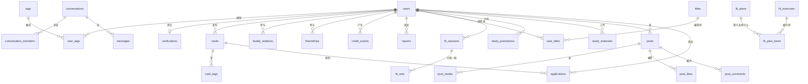

# 03 · 数据设计（uniCloud 云数据库 · 文档型）

> v0.5（2026-10-18）：§2.3 补「一对人 → N 条关系，但界面上必须只有一张卡」：`buddy_relations` 唯一性键改为 (`user_a_id`, `user_b_id`, `category`, `status`)，`conversations` 唯一性键改为 `user_pair_key`；并明确「按人合并」必须写在云函数里。集合总数不变，仍为 **32**。
> v0.4（2026-10-16）：`buddy_relations` 补 `label_a_color` / `label_b_color` 两个颜色字段（预设色 key，8 个闪亮色见 §2.3；前端用内联 `background-color` + 斜向白色高光实现反光质感）。**不新增集合**，集合总数不变，仍为 **32**（见 §2.3 与 §7）。
> v0.3（2026-10-16）：新增内容流（同频圈）4 个集合 `posts` / `post_media` / `post_likes` / `post_comments`（见 §2.8）；心理疏导**不新建表**，复用 `conversations(type='ai')` + `ai_messages` + `ai_usage_daily`（见 §2.4）。集合总数 **28 → 32**（原标题写的「26 个」漏算了 `admins` 与 `notifications`）。
> v0.2（2026-10-16）：整份改写为 uniCloud 云数据库版（文档型，基于 MongoDB）。表 → 集合，外键 → 存 `_id` 字符串。
> 配套文档：[01-requirements.md](./01-requirements.md) · [02-pages-and-flows.md](./02-pages-and-flows.md) · [04-tech-stack.md](./04-tech-stack.md) · [06-chat-transport.md](./06-chat-transport.md)
> 图例：🔑 主键 · 🔗 引用（存 `_id` 字符串）· ⚡ 需要索引

---

## 0. 先读懂 5 条约定的"为什么"

如果你以前只见过 MySQL 那种表格数据库，这一章是给你补的。**这 5 条后面的所有设计都建立在这里。**

| 约定 | 是什么 | 为什么这么定 |
|---|---|---|
| **集合 = 原来的表** | uniCloud 云数据库是**文档型**（基于 MongoDB），一行数据叫一个"文档"，一批文档放在一个"集合"里 | 集合 ≈ 表、文档 ≈ 行、字段 ≈ 列。你原来理解的表结构**几乎没有变**，只是不能再 join |
| **`_id` 是主键** | 每条文档创建时自动生成的字符串 id（你可以自己指定，也可以让它自动生成） | 云数据库自带，不用自己造 id 生成器；云函数之间传的就是这个字符串 |
| **引用用存 `_id`（字符串），不用外键** | 比如 `cards.owner_id` 里存的是 `users` 里那条文档的 `_id` 字符串 | 文档型数据库**没有外键约束，也没有 join**。好处是简单、快；坏处是"删了用户，他发的卡片不会自动消失"，所以**清理关联数据要在云函数里手动做** |
| **时间统一存毫秒时间戳（数字）** | 例如 `1760544000000`，字段名统一 `created_at` / `updated_at` | 二选一必须定死，否则排序和"查今天的数据"会出错。选毫秒时间戳的原因：① 数字比时间，天然可排序、可做范围查询；② 没有时区歧义（字符串如果格式不统一，`>= '2026-10-16'` 这种查询很容易漏数据）；③ 时间戳减一天就是 `-86400000`，算"最近 7 天"不用引库。**前端显示时再 `new Date(ts)` 转成本地时间** |
| **软删除** | 需要保留历史的文档加 `deleted_at`（0 或 null = 未删除） | 举报、订单、消息这类要留证据；但**列表查询必须都带上 `deleted_at` 条件**，否则"删了还看得见" |

> 补充：`_id` 用自动生成的字符串，不要用自增数字——云数据库高并发下没有可靠的"自增 id"，这是常见新手坑。

---

## 1. 实体关系（鸟瞰）



> 注意：这些连线**只是逻辑关系**（靠字段里存的 `_id` 体现），数据库**不会**帮你保证一致性。所以：**凡是"一次要改好几个集合"的操作，都写在一个云函数里，用事务包起来。**

---

## 2. 集合清单（32 个）

### 2.1 账号与资料（5 个）

| 集合 | 用途（一句话） | 关键字段 | 索引 ⚡ |
|---|---|---|---|
| `users` | 用户账号与资料 | `_id`、`phone`(string,唯一)、`password_hash`(string,加盐哈希)、`nickname`(string)、`user_no`(string,展示用用户号)、`avatar_url`(string)、`school`(string)、`school_id`(string,可为空)、`grade`(string)、`gender`(string)、`bio`(string,≤50字)、`is_verified`(bool)、`credit_score`(int,默认80)、`current_title_id`(string,佩戴称号)、`status`(string: normal/banned)、`last_active_at`(number)、`real_name_verify_id`(string,为空)、`created_at`/`updated_at`(number) | `phone`(唯一)、`user_no`(唯一)、`school_id`、`credit_score`、`is_verified` |
| `verifications` | 学生认证申请 | `_id`、`user_id`、`card_image_url`(string)、`real_name_optional`(string,可选，最小化采集)、`status`(string: pending/approved/rejected)、`reject_reason`(string)、`reviewed_by`(string)、`reviewed_at`(number)、`created_at` | `user_id`、`status` |
| `tags` | 标签字典 | `_id`、`name`(string)、`category`(string: 作息/强度/性格/兴趣/偏好/科目)、`sort`(int)、`active`(bool) | `category`+`active` |
| `user_tags` | 用户选了哪些标签 | `_id`、`user_id`、`tag_id`、`weight`(number,默认1；性格类1.5)、`created_at` | `user_id`、`tag_id`、复合 `(user_id, tag_id)` 唯一 |

> 唯一性怎么办？文档型数据库**没有联合主键**。做法：建**唯一索引**（uniCloud 控制台里可以建），并且**云函数插入前先查一次**，双保险。

| 集合 | 用途（一句话） | 关键字段 | 索引 ⚡ |
|---|---|---|---|
| `admins` | 后台账号（与用户表分开，避免权限混用） | `_id`、`username`(string)、`password_hash`(string)、`role`(string: reviewer/super)、`created_at` | `username`(唯一) |

### 2.2 搭子与匹配

| 集合 | 用途（一句话） | 关键字段 | 索引 ⚡ |
|---|---|---|---|
| `cards` | 搭子卡片（一条"想找人一起做某件事"的需求） | `_id`、`owner_id`、`type`(string: study/fitness/photo/meal/sport/other)、`title`(string ≤30字)、`description`(string ≤200字)、`school_id`(string)、`city_code`(string)、`location_name`(string)、`latitude`/`longitude`(number,可空)、`start_time`/`end_time`(number,可空)、`expected_people`(int,默认1)、`status`(string: open/matched/closed/removed)、`created_at`/`updated_at` | `(status, type, created_at)`、`owner_id`、`school_id`、`city_code` |
| `card_tags` | 卡片带了哪些标签 | `_id`、`card_id`、`tag_id` | `card_id`、`tag_id` |
| `applications` | 申请（"我想搭"） | `_id`、`card_id`、`applicant_id`、`message`(string ≤100字)、`status`(string: pending/accepted/rejected/canceled)、`decided_at`(number)、`created_at` | `card_id`+`status`、`applicant_id` |
| `matches` | 匹配记录（答辩时能证明"算法真的在跑"） | `_id`、`user_id`、`card_id`、`score`(number 0–100)、`common_tag_count`(int)、`created_at` | `user_id`+`created_at` |

> 业务规则（要写进云函数校验，不是写进数据库）：
> - 同一 `(card_id, applicant_id)` 只能有一条 `pending`；
> - **发布者不能申请自己的卡片**；
> - 每人每天最多发 5 条卡片；
> - `credit_score < 60` 禁止发卡片。

### 2.3 关系：搭子 / 好友

| 集合 | 用途（一句话） | 关键字段 | 索引 ⚡ |
|---|---|---|---|
| `buddy_relations` | 搭子关系（**双向一条**记录） | `_id`、`user_a_id`、`user_b_id`（约定 `user_a_id < user_b_id`，避免重复）、`source_card_id`(可空)、`label_a`(string,A给这段关系起的标签，**≤8字**)、`label_b`(string)、`label_a_color`(string,预设色 **key**，如 `shine-yellow`；可空=用默认色)、`label_b_color`(string)、`status`(string: active/ended)、`ended_by`(string)、`ended_at`(number)、`created_at` | `user_a_id`、`user_b_id`、复合 `(user_a_id, user_b_id)` 唯一、`status` |
| `friendships` | 好友关系（双向一条） | `_id`、`user_a_id`、`user_b_id`（同样约定小 id 在前）、`created_at` | 复合 `(user_a_id, user_b_id)` 唯一 |
| `friend_requests` | 好友申请 | `_id`、`from_user_id`、`to_user_id`、`source`(string: buddy/search)、`status`(string: pending/accepted/rejected)、`created_at` | `to_user_id`+`status`、`from_user_id` |

> **★★ 搭子标签是「私有备注」（2026-10-18 定案，不可回退）**：`label_a` 只属于 `user_a`、`label_b` 只属于 `user_b`，**各写各的、互相不可见**。用户原话：「自己只能看到自己给对面起的搭子标签，就类似于备注一样，但是不要与用户备注混为一谈」。
> - 写：任何入口（`card-apply` 同意申请后接受方自命名、`buddy-tag` 改标签、`buddy-invite` 接受邀请时自命名）**只允许写自己那一侧**。谁也不能替对方写备注。
> - 读：任何云函数**不得把对方那一侧的 `label_*` 下发给当前用户**。已落实在 `buddy-list`（不再返回 `his_label` / `his_label_color`）、`user-profile`（`relations[]` 不再返回 `his_label`）、`buddy-invite`（`accept` 不回传发起方标签；`list` 仅在 `box='out'` 时回显自己写的标签）、`message-conversations`（只取我这一侧的 label 拼 `buddy_tags`）。
> - 展示：界面上的「你叫他」「他叫你」两行已删除。邀请卡片、通知文案也只按**类型**说「想和你做学习搭子」，不暴露对方写的名字。
> - 与「用户备注」的区别：搭子标签绑定的是**一段关系**（同一对人在不同 category 下可以各有标签），用户备注绑定的是**一个人**；两者字段、表、生命周期都不同，**不要合并**。
>
> **★★ 一对人 → N 条关系，但界面上必须只有一张卡（2026-10-18 定案）**：
> - 数据层：`buddy_relations` 的唯一性键是 **(`user_a_id`, `user_b_id`, `category`, `status='active'`)**，不是 (`user_a_id`, `user_b_id`)。同一对人在 `study` / `fitness` / `photo` 下可以同时各有一段 active 关系，各自有独立的 `label_a` / `label_b`。
> - 会话层：`conversations` 的唯一性键是 **`user_pair_key`**（两个 `_id` 排序后 `A|B` 拼接），**不是** `buddy_relation_id`。一对人全局只有一条 direct 会话，它同时服务于这个人名下的所有关系。`buddy_relation_id` 字段保留但**不参与判重**（老数据仍可能带着它，供兼容反查）。
> - 展示层：任何"我的搭子"类列表**必须按人合并**，一条记录 = 一个人，其 `tags[]` 带上他名下全部关系产生的标签。**合并写在云函数里**（`buddy-list` 返回的就是按人合并后的结构），前端不再自己判断——否则每多一个读这份数据的页面就要重新实现一次合并，迟早漏一处（消息页、聊天页、我的搭子页都栽过这个坑）。
> - 反例（已修）：`pages/buddy/buddy.vue` 曾直接 `v-for` 关系行，同一个人有几段关系就渲染几张卡；列表 `:key` 也不能用 `relation_id`，要用 `other_user_id`（一条卡 = 一个人）。
>
> **搭子自定义标签的颜色（2026-10-16 新增）**：`label_a_color` / `label_b_color` 各存一个**预设色 key（字符串）**，**不存 hex**。理由：① 颜色是**封闭的 8 选 1**，不是自由取色盘——存 key 让前端只认一份色表、换色（改 hex）不用回刷历史数据，也免得用户从外部粘贴任意色值把界面搞脏；② 校验简单，`enum` 就能挡住非法值（存 hex 则要写格式正则，还挡不住"合法但不属于这 8 个"的颜色）；③ 与既有风格一致——本项目所有"枚举型"字段（`type` / `status` / `kind` / `rarity`）都是存英文 key，中文名与 hex 由前端色表负责映射。
> 预设色就是 **8 个「带反光质感的闪亮色」**：`shine-yellow` 闪耀黄 `#ffde00`、`shine-orange` 熔岩橙 `#ff4d00`、`shine-rose` 荧光粉 `#ff5fa2`、`shine-violet` 霓虹紫 `#a855f7`、`shine-cyan` 电光青 `#22d3ee`、`shine-mint` 薄荷绿 `#34d399`、`shine-blue` 宝石蓝 `#3b82f6`、`shine-gold` 香槟金 `#e9c46a`。**反光质感由前端实现**：色块与标签用内联 `background-color` 上底色，再叠一道**斜向白色高光**（如 `linear-gradient(115deg, rgba(255,255,255,.55) 0%, rgba(255,255,255,0) 45%)`）；这层高光是纯展示，**不入库**，所以数据库只存颜色 key。

### 2.4 聊天

| 集合 | 用途（一句话） | 关键字段 | 索引 ⚡ |
|---|---|---|---|
| `conversations` | 会话 | `_id`、`type`(string: direct/ai)、`buddy_relation_id`(可空，用于显示搭子标签)、`last_message_id`(string,排序用)、`last_message_at`(number,排序用)、`created_at`/`updated_at` | `last_message_at`、`type` |
| `conversation_members` | 会话成员（谁在这个会话里、未读数） | `_id`、`conversation_id`、`user_id`、`unread_count`(int,默认0)、`last_read_message_id`(string,已读游标) | 复合 `(conversation_id, user_id)` 唯一、`(user_id, unread_count)` |
| `messages` | 消息 | `_id`、`conversation_id`、`sender_id`、`type`(string: text/image/system)、`content`(string,文本或图片 URL)、`client_msg_id`(string,客户端生成，**去重与重发用**)、`created_at`(number) | `(conversation_id, created_at)`、复合 `(conversation_id, client_msg_id)` 唯一 |
| `ai_messages` | AI 机器人会话消息（**与真人消息分开存**） | `_id`、`user_id`、`role`(string: user/assistant)、`content`(string)、`tokens`(int,统计用量)、`created_at` | `(user_id, created_at)` |
| `ai_usage_daily` | AI 每日用量（做额度的依据） | `_id`、`user_id`、`date_key`(string,形如 `2026-10-16`，用服务器时间生成)、`count`(int)、`updated_at` | 复合 `(user_id, date_key)` 唯一、`date_key`（全局日额度要统计当天所有记录） |

> 为什么 AI 消息要和真人消息分开？① 计额度和审计方便；② AI 的历史将来可以单独清理；③ 万一 AI 接口出问题，不会污染真实聊天记录。
> **心理疏导（情绪引导机器人）不新建表**：直接复用 `conversations(type='ai')`（每个用户一条固定 AI 会话，与消息页的固定项是同一个）+ `ai_messages` + `ai_usage_daily`（额度规则见 §4.5）。本期心理疏导只保留首页入口与占位、不实际调用 AI，所以这 3 个集合暂时只放演示数据。

### 2.5 信誉、举报、称号

| 集合 | 用途（一句话） | 关键字段 | 索引 ⚡ |
|---|---|---|---|
| `credit_events` | 信誉流水（**分数的唯一真相**） | `_id`、`user_id`、`delta`(int: +2/−5/−10/+5)、`reason_code`(string: buddy_completed/no_show/report_upheld/verified/admin_adjust)、`reason_text`(string,给用户看的人话)、`ref_id`(string,可空)、`score_after`(int,变更后分数，便于画曲线)、`created_at` | `(user_id, created_at)` |
| `reports` | 举报 | `_id`、`reporter_id`、`target_type`(string: user/card/message/material)、`target_id`(string)、`reason`(string: harassment/fake/ad/other)、`detail`(string)、`status`(string: pending/upheld/dismissed)、`handled_by`(string)、`handled_at`(number)、`created_at` | `(status, created_at)`、`(reporter_id, target_type, target_id)` 唯一 |
| `titles` | 称号库 | `_id`、`name`(string)、`desc`(string)、`rarity`(string: common/rare/epic)、`condition_type`(string: buddy_count/streak_days/credit_score/verified_days/custom)、`condition_value`(int)、`condition_text`(string,给用户看的解锁条件)、`icon_url`(string)、`active`(bool) | `rarity` |
| `user_titles` | 用户获得了哪些称号 | `_id`、`user_id`、`title_id`、`obtained_at`(number)、`is_equipped`(bool,同时只有1个为true) | 复合 `(user_id, title_id)` 唯一、`user_id` |

### 2.6 健身 / 学习 / 百科

| 集合 | 用途（一句话） | 关键字段 | 索引 ⚡ |
|---|---|---|---|
| `fit_exercises` | 动作库（66 条内置） | `_id`、`name`(string)、`alias`(string[])、`muscle`(string: chest/back/shoulder/biceps/triceps/legs/glutes/core/forearm/calf/cardio/stretch)、`muscle_sub`(string,具体部位)、`equipment`(string: barbell/dumbbell/machine/cable/bodyweight/kettlebell/band/other)、`mechanics`(string: compound/isolation)、`force`(string: push/pull/static)、`level`(string: beginner/intermediate/advanced)、`default_sets`(int)、`default_reps`(string,如 `8-12`)、`default_rest`(int,秒)、`secondary`(string[],协同肌群)、`tip`(string,要点)、`sort`(int)、`active`(bool) | `(active, muscle)`、`(active, equipment)` |
| `fit_plans` | 训练计划（5 套官方模板，表结构与个人计划共用） | `_id`、`user_id`(string,官方模板为空)、`name`(string)、`goal`(string: muscle/fat_loss/shaping/stretch)、`source`(string: template/custom)、`day_count`(int,这套计划几天一循环)、`sort`(int)、`active`(bool)、`created_at` | `(active, sort)` |
| `fit_plan_items` | 计划里「第几天练哪个动作」 | `_id`、`plan_id`、`day_index`(int 1-31)、`exercise_id`(指向 `fit_exercises._id`)、`exercise_name`(string,冗余)、`sets`(int)、`reps`(string)、`rest`(int,秒)、`sort`(int) | `(plan_id, day_index, sort)` |
| `fit_sessions` | 一次训练（**打卡的唯一真相**） | `_id`、`user_id`、`plan_id`、`plan_name`(string,冗余，计划改名后历史不变)、`plan_day_index`(int)、`log_date`(string,形如 `2026-10-16`)、`started_at`、`finished_at`、`duration_sec`(int)、`total_sets`(int,不含热身)、`total_volume`(number,kg)、`muscles`(string[],练到的部位)、`note`(string)、`status`(string: ongoing/done/abandoned)、`updated_at` | `(user_id, status)`、`(user_id, log_date)` |
| `fit_sets` | 一次训练里的**每一组** | `_id`、`session_id`、`user_id`、`exercise_id`、`exercise_name`(string,冗余)、`muscle`(string,冗余)、`set_index`(int)、`weight`(number,kg,支持 0-500)、`reps`(int,1-200)、`rest_sec`(int)、`is_warmup`(bool)、`is_pr`(bool,**写入时判定并落库**)、`est_1rm`(number,估算 1RM)、`done_at`、`created_at` | `(session_id, exercise_id)`、`(user_id, exercise_id, weight)` |
| `study_pomodoros` | 番茄钟记录 | `_id`、`user_id`、`minutes`(int 1-180，**记的是设定时长**，不是实际用了多久)、`started_at`、`finished_at`、`completed`(bool,false=中途放弃)、`subject`(string ≤20 字)、`log_date`(string,按 `finished_at` 算) | `(user_id, log_date)` |
| `study_materials` | 资料共享 | `_id`、`user_id`、`title`(string)、`course`(string)、`description`(string)、`file_url`(string)、`file_type`(string)、`file_size`(int,≤20MB)、`status`(string: pending/approved/rejected)、`download_count`(int)、`created_at` | `(status, created_at)`、`user_id` |
| `encyclopedia` | 每日百科 | `_id`、`title`(string)、`content`(string)、`category`(string: study/health/life/campus)、`publish_date`(string,形如 `2026-10-16`)、`active`(bool)、`created_at` | `publish_date`(唯一) |

> `log_date` / `publish_date` / `date_key` 这类"按天"的字段用 `YYYY-MM-DD` 字符串而不是时间戳，因为要能按天分组和比较（时间戳每次都不一样，做不到）。这是 03 文档里唯一不按毫秒时间戳存的时间字段，属于刻意例外。
>
> **唯一索引只加在真正"一天一条"的地方**（`encyclopedia.publish_date`）。`fit_sessions.log_date` 与 `study_pomodoros.log_date` **故意不加唯一约束** —— 一天练两次、记多个番茄都是正常的，约束死反而会挡住用户。

### 2.7 运营

| 集合 | 用途（一句话） | 关键字段 | 索引 ⚡ |
|---|---|---|---|
| `notifications` | 站内通知（先只做列表，不做推送） | `_id`、`user_id`、`type`(string)、`title`(string)、`content`(string)、`ref_id`(string)、`is_read`(bool)、`created_at` | `(user_id, is_read)` |

### 2.8 内容流（同频圈，P2 / 预留；本期只读占位数据）

| 集合 | 用途（一句话） | 关键字段 | 索引 ⚡ |
|---|---|---|---|
| `posts` | 日常内容帖（同频圈里的"图文 / 视频 / 吐槽"卡片） | `_id`、`author_id`、`scope`(string: school/district/national，**同校 / 地区 / 发现 三栏切换靠它**；`district`=同城·周边，`national`=发现=全国)、`kind`(string: image/video/text，**图文 / 视频 / 吐槽 三种形态**；吐槽 = text)、`content`(string ≤500字)、`school_id`(string，冗余作者学校，同校流筛选用)、`city_code`(string，冗余作者城市，**地区流筛选用**)、`media_count`(int,冗余，卡片渲染用)、`cover_url`(string,封面)、`like_count`/`comment_count`(int,冗余计数)、`status`(string: pending/approved/rejected/removed，**审核状态**)、`reject_reason`(string)、`reviewed_by`(string)、`reviewed_at`(number)、`deleted_at`(number,软删除)、`created_at`/`updated_at` | `(status, scope, created_at)`、`(status, kind, created_at)`、`author_id`、`school_id`、`city_code` |
| `post_media` | 帖子里的图片 / 视频 | `_id`、`post_id`、`type`(string: image/video)、`url`(string,云存储 URL)、`thumb_url`(string,视频封面)、`width`/`height`(int)、`duration`(int,视频秒数，图片为 0)、`file_size`(int,字节，单个 ≤20MB)、`sort`(int)、`created_at` | 复合 `(post_id, sort)` |
| `post_likes` | 点赞 | `_id`、`post_id`、`user_id`、`created_at` | 复合 `(post_id, user_id)` 唯一、`user_id` |
| `post_comments` | 评论 / 吐槽回复 | `_id`、`post_id`、`author_id`、`content`(string ≤200字)、`reply_to_comment_id`(string,可空)、`status`(string: approved/removed)、`deleted_at`(number)、`created_at` | `(post_id, created_at)`、`author_id` |

> 业务规则（同 §2.2 的写法，都在云函数里校验，不是写进数据库）：
> - 本期**只做占位原型**：只有静态演示数据 + 客户端只读，发布 / 上传 / 点赞 / 评论的云函数排到 P2；
> - 帖子审核：`pending` → `approved`（公开可见）/ `rejected`（驳回，必填 `reject_reason`）；违规走 `removed`，不物理删除；
> - `scope='school'` 的帖子只在同校流出现（靠冗余的 `school_id` 过滤）；`scope='district'` 只在地区流出现（靠冗余的 `city_code` 过滤）；`scope='national'` 就是「发现」频道（全国）；未认证用户没有 `school_id`，只给看地区与发现；
> - `like_count` / `comment_count` 由点赞 / 评论的云函数在**同一事务**里 +1 / −1，不靠实时聚合。

---

## 3. DB Schema 详解（这是 uniCloud 最该学的一块）

### 3.1 DB Schema 是干什么的

在 uniCloud 里，每个集合可以配一份 **DB Schema**（一份 JSON）。它同时干三件事：

1. **定义字段类型与必填**（`bsonType` / `required`）——相当于 MySQL 的建表约束，帮你挡住写错的脏数据；
2. **定义谁能读写哪几行**（`permission.read/create/update/delete`）——相当于后端的接口鉴权；
3. **决定客户端能不能直接读这个集合**（`"client": true` 才允许客户端 db 直接读）。

> **最关键的一句**：权限表达式能挡"哪些字段能读"，但**挡不住"哪几行能读"**（读操作拿不到具体文档的上下文）。所以：**写操作我们全部交给云函数**，客户端只读公开数据；**所有"这行数据是不是你的"的校验，必须在云函数里再做一遍**。

### 3.2 `users` 集合 DB Schema

```json
{
  "collection": "users",
  "version": "1.0",
  "description": "用户账号与资料。**写操作一律走云函数**（注册、改资料、改信誉分、封禁）。",
  "client": true,
  "db": {
    "bsonType": "object",
    "required": ["phone", "password_hash", "nickname", "created_at"],
    "permission": {
      "read": true,
      "create": false,
      "update": false,
      "delete": false
    },
    "properties": {
      "_id": { "description": "主键，自动生成" },
      "phone": { "bsonType": "string", "description": "手机号，唯一，登录用" },
      "password_hash": {
        "bsonType": "string",
        "description": "加盐哈希后的密码。绝不存明文。不要放进读白名单",
        "permission": { "read": false }
      },
      "nickname": { "bsonType": "string", "minLength": 1, "maxLength": 20 },
      "user_no": { "bsonType": "string", "description": "展示用用户号，如 U100238，方便搜人加好友" },
      "avatar_url": { "bsonType": "string" },
      "school": { "bsonType": "string" },
      "school_id": { "bsonType": "string", "description": "学校字典 id，可为空；同校筛选靠它" },
      "grade": { "bsonType": "string" },
      "gender": { "bsonType": "string", "enum": ["male", "female", "secret"] },
      "bio": { "bsonType": "string", "maxLength": 50, "description": "一句话简介，≤50 字" },
      "is_verified": { "bsonType": "bool", "description": "学生认证是否通过；卡片标识、同校频道都看它" },
      "credit_score": {
        "bsonType": "int",
        "minimum": 0,
        "maximum": 100,
        "description": "信誉分。默认 80；只能由云函数按 credit_events 流水推导后写入"
      },
      "current_title_id": { "bsonType": "string", "description": "当前佩戴的称号 _id，可为空" },
      "status": { "bsonType": "string", "enum": ["normal", "banned"] },
      "last_active_at": { "bsonType": "number", "description": "最近活跃时间（毫秒时间戳）" },
      "created_at": { "bsonType": "number", "description": "创建时间（毫秒时间戳）" },
      "updated_at": { "bsonType": "number" }
    }
  }
}
```

**逐段解释**：

| 这一段 | 在做什么 | 为什么 |
|---|---|---|
| `"client": true` | 允许客户端直接读这个集合 | 需要展示他人资料（卡片详情页要显示发布者头像/昵称/信誉分） |
| `"read": true` | 任何登录用户都能读 | 资料本来就是公开的；真正的敏感字段用 `.field()` 白名单挡 |
| `"create"/"update"/"delete": false` | **谁都不能从客户端直接写** | 这是本项目的总原则。注册要查手机号是否重复、要算哈希；改信誉分要写流水——**这些校验只能放云函数**，一旦放开客户端写，规则就形同虚设 |
| `password_hash` 的 `"permission": {"read": false}` | 连读都不给 | 双保险：即便哪天 read 白名单写漏了，哈希也读不到 |
| `bsonType` / `required` | 类型与必填校验 | 挡脏数据。注意 `credit_score` 用 `int` 且限 0–100，防止出现 `"80"` 这种字符串分数导致 `>= 60` 判断出错 |
| 毫秒时间戳的 `"bsonType": "number"` | 统一时间类型 | 前面 §0 定好的：数字，能排序能比大小，没有时区歧义 |

> **读白名单怎么写**：想精确控制客户端能读哪些字段，在云函数里查询时用 `.field()`，例如
> `db.collection('users').field({ nickname: true, avatar_url: true, school: true, credit_score: true }).get()`
> 这样即使 schema 的 `read` 是 `true`，返回里也不会带 `phone` / `password_hash`。**能不带就别带。**

### 3.3 `cards` 集合 DB Schema

```json
{
  "collection": "cards",
  "version": "1.0",
  "description": "搭子卡片。发布/编辑/下架走云函数；客户端只读。",
  "client": true,
  "db": {
    "bsonType": "object",
    "required": ["owner_id", "type", "title", "description", "school_id", "status", "created_at"],
    "permission": {
      "read": true,
      "create": false,
      "update": false,
      "delete": false
    },
    "properties": {
      "_id": { "description": "主键" },
      "owner_id": { "bsonType": "string", "description": "发布者 users._id（存字符串，不是外键）" },
      "type": {
        "bsonType": "string",
        "enum": ["study", "fitness", "photo", "meal", "sport", "other"],
        "description": "需求类型；匹配算法要按它做硬过滤"
      },
      "title": { "bsonType": "string", "minLength": 1, "maxLength": 30 },
      "description": { "bsonType": "string", "minLength": 1, "maxLength": 200 },
      "school_id": { "bsonType": "string", "description": "冗余发布者学校，用于同校筛选，避免每次都回查 users" },
      "city_code": { "bsonType": "string", "description": "城市编码，地区范围筛选用" },
      "location_name": { "bsonType": "string" },
      "latitude": { "bsonType": "number", "description": "可为空；附近排序用" },
      "longitude": { "bsonType": "number" },
      "start_time": { "bsonType": "number", "description": "可为空；按类型选填（毫秒时间戳）" },
      "end_time": { "bsonType": "number" },
      "expected_people": { "bsonType": "int", "minimum": 1, "maximum": 10, "description": "想找几个人，默认 1；MVP 只做 1 对 1" },
      "status": {
        "bsonType": "string",
        "enum": ["open", "matched", "closed", "removed"],
        "description": "open=大厅可见；removed=被下架/违规，不物理删除"
      },
      "created_at": { "bsonType": "number" },
      "updated_at": { "bsonType": "number" }
    }
  }
}
```

**逐段解释**：

| 这一段 | 在做什么 | 为什么 |
|---|---|---|
| `status` 用 `removed` 而不是删文档 | 软删除 | 举报处理、答辩复盘都要能查到这张卡片；物理删除就没了 |
| `school_id` 冗余存一份 | 发布卡片时把发布者的学校抄一份进来 | 文档型数据库不能 join，大厅筛选"同校"如果每次都回查 `users`，一张卡片列表要查几十次。**冗余一个字段换取查询次数，这是文档型的常规做法** |
| `create: false` | 发布卡片必须走云函数 | 云函数里要一起校验：每天 ≤5 条、信誉分 ≥60、`card_tags` 要同时写、`school_id` 要从当前用户取（不能让客户端随便传别人的学校）——**客户端直写绕不过这些** |
| `expected_people` 限 1–10 | 类型校验 | 防止出现 0 人或 999 人这种脏数据 |

### 3.4 `conversations` 集合 DB Schema

```json
{
  "collection": "conversations",
  "version": "1.0",
  "description": "会话。创建走云函数（如同意申请时自动开会话）；客户端只读。",
  "client": true,
  "db": {
    "bsonType": "object",
    "required": ["type", "created_at"],
    "permission": {
      "read": true,
      "create": false,
      "update": false,
      "delete": false
    },
    "properties": {
      "_id": { "description": "主键" },
      "type": { "bsonType": "string", "enum": ["direct", "ai"], "description": "direct=一对一真人；ai=机器人会话" },
      "buddy_relation_id": {
        "bsonType": "string",
        "description": "可空。搭子会话关联 buddy_relations._id，用于在聊天页顶部显示搭子标签（文字 + label_a_color/label_b_color 的闪亮底色）；解除搭子后置空"
      },
      "last_message_id": { "bsonType": "string", "description": "最后一条消息 _id，会话列表展示与排序用" },
      "last_message_at": { "bsonType": "number", "description": "最后一条消息时间（毫秒），会话列表倒序排它" },
      "created_at": { "bsonType": "number" },
      "updated_at": { "bsonType": "number" }
    }
  }
}
```

**逐段解释**：

| 这一段 | 在做什么 | 为什么 |
|---|---|---|
| `buddy_relation_id` 可空 | 真人会话可能是好友私聊（没有搭子关系） | 一条会话"是不是搭子"看这个字段有没有值，不需要另建表 |
| `last_message_id` + `last_message_at` | 把"最后一条消息"的信息抄进会话 | 会话列表按时间倒序只需要查 `conversations` 一个集合，**不用为每个会话去 `messages` 里查最后一条**（那是 N+1 查询，几十个会话会明显变慢）。发消息的云函数里顺手更新这两个字段 |
| `create/update/delete: false` | 会话不能由客户端创建 | 开会话是有业务含义的动作（同意申请、加好友），必须在云函数里做，顺便写 `conversation_members` |

> 一个隐患要写清楚：**`read: true` 意味着任何登录用户理论上能读到任意会话文档的元信息**（它只有 id 和时间，没有消息内容）。要更严，就把 `read` 改成 `false`，让云函数返回会话列表。**MVP 建议改成 `false`**，因为会话列表本来就要走云函数算未读数，顺手更安全。

### 3.5 `messages` 集合 DB Schema

```json
{
  "collection": "messages",
  "version": "1.0",
  "description": "消息。写操作只走云函数 message-send；读也走云函数 fetchSince（客户端不直连）。",
  "client": false,
  "db": {
    "bsonType": "object",
    "required": ["conversation_id", "sender_id", "type", "content", "client_msg_id", "created_at"],
    "permission": {
      "read": false,
      "create": false,
      "update": false,
      "delete": false
    },
    "properties": {
      "_id": { "description": "主键；同时充当轮询游标（fetchSince 用它做条件）" },
      "conversation_id": { "bsonType": "string", "description": "所属会话 conversations._id" },
      "sender_id": { "bsonType": "string", "description": "发送者 users._id；系统消息可为 'system'" },
      "type": { "bsonType": "string", "enum": ["text", "image", "system"] },
      "content": { "bsonType": "string", "description": "文本内容，或图片在云存储里的 URL" },
      "client_msg_id": {
        "bsonType": "string",
        "description": "客户端生成的唯一 id。**用来去重**：网络抖动导致重复发送时，不会出现两条一样的消息；也是本地乐观气泡回填的依据"
      },
      "created_at": { "bsonType": "number", "description": "服务端时间（毫秒时间戳）。**不要用客户端时间**，否则手机时间不准会让消息排序错乱" }
    }
  }
}
```

**逐段解释**：

| 这一段 | 在做什么 | 为什么 |
|---|---|---|
| `"client": false` + 四个权限全 `false` | **客户端完全不能直连这个集合** | 消息是最敏感的数据。客户端要读消息，只能调云函数（云函数里校验"你是不是这个会话的成员"），这样**越权读别人聊天记录在架构上就不可能** |
| `client_msg_id` 必填 | 每条消息都带客户端生成的 id | ① **去重**：同一个 `client_msg_id` 已经存在就直接返回老的那条，不再写入；② 页面里用它在本地列表里找到"发送中"那条气泡，替换成服务端消息并把状态改成"已送达" |
| `created_at` 用服务端时间 | 云函数里 `Date.now()` | 手机时间可以被用户改。**用客户端时间排序，会出现"新消息插到最上面"这种诡异 bug** |
| 没写 `"_id"` 的类型 | 自动生成字符串 | 轮询 `fetchSince(lastMessageId)` 就是"取 `_id` 在它之后的消息"。**注意**：自动 `_id` 不是严格递增的，所以更稳的写法是**同时用 `created_at` 排序 + `_id` 做去重**，见 §5 的算法说明 |

---

## 4. 业务规则（这些是"答辩会被问"的地方，逐条都能解释）

### 4.1 信誉分：分数只由流水推导

| 事件 | 变化 |
|---|---|
| 初始（注册完成） | 80 |
| 完成一次搭子（双方确认） | **+2** |
| 放鸽子（对方标记并确认） | **−5** |
| 举报成立（管理员判定） | **−10** |
| 认证通过 | **+5** |
| `< 60` | 禁止发布卡片、禁止进入同校频道；只能被浏览 |
| 管理员调整 | 走 `admin_adjust`，必须填写原因 |

> **规则：`users.credit_score` 不允许被直接改，只能由 `credit_events` 流水推导。**
> 为什么：① 防作弊（谁都改不了分，只能"产生一条事件"）；② 可解释（用户问"为什么扣我分"，直接把流水翻出来）；③ 出 bug 可以重算（把某个用户所有流水加起来就是他的分）。
> 怎么做：每次变化都在**一个云函数、一个事务**里完成——插入一条 `credit_events`（带 `score_after`）+ 更新 `users.credit_score`。`score_after = 变更前分数 + delta`，用一个专门的云函数（如 `credit-apply`）统一处理，**所有扣分加分都调它，绝不在别处手写 `credit_score`**。

### 4.2 状态机（四处，别写错）

```
认证 verifications.status:  pending → approved | rejected
                              ↑                    │
                              └──── 重新提交 ───────┘
举报 reports.status:        pending → upheld（成立，扣 −10） | dismissed（驳回）

卡片 cards.status:          open → matched（有人同意） → closed（完成/关闭）
                              └→ removed（违规下架，管理员）
内容流 posts.status:        pending（待审） → approved（公开可见） | rejected（驳回）
                              └→ removed（违规下架，管理员）
```

> 约束：**同一用户同时只允许一条 `pending` 的认证申请**（云函数插入前先查，否则用户连点提交按钮会生成一堆申请）。审核中不能重复提交——这是 US-03 的验收标准。

### 4.3 称号库与稀有度

- 先做 **12 个**：3 个易得（完善资料 / 首次认证 / 首次完成搭子）+ 9 个稀有。
- `rarity`：`common` / `rare` / `epic`，决定称号墙上的展示样式（置灰 / 高亮 / 特效）。
- 达成条件时：云函数在对应事件后检查 `titles` 里 `active=true` 的项，满足 `condition_value` 就插一条 `user_titles`，并弹一次获得提示。
- 佩戴：`user_titles.is_equipped` **同时只有 1 个为 true**，切换时先把旧的置 false 再置新的（同一事务）。
- 未获得的称号在称号墙**置灰 + 显示 `condition_text`**——这是 US-32 的验收标准，文案存在 `titles` 里，后台可改。

### 4.4 资料共享：先审后发

`study_materials.status`：`pending` → `approved`（他人可下载）/ `rejected`。
**上传后默认 `pending`，列表只查 `approved`**。文件放云存储的 `material/` 目录，类型限 PDF/图片/文档，单个 ≤ 20MB。

### 4.5 AI 每日额度：双上限

| 限制 | 怎么算 | 超了怎么办 |
|---|---|---|
| **每用户每日 20 条** | 查 `ai_usage_daily` 里 `(user_id, 今天)` 的 `count` | 返回人话提示「今天的 AI 额度用完了，明天再来」 |
| **全局日额度** | 把今天所有 `ai_usage_daily` 文档的 `count` 加起来 | 返回「今天 AI 使用的人太多，稍后再试」 |

> **顺序很重要**：先查额度 → 再调 DeepSeek → 最后写 `ai_messages` 和 `ai_usage_daily`。如果先调 API 再查额度，被刷的时候钱已经花掉了。
> `date_key` 用**服务器时间**生成 `YYYY-MM-DD`；`(user_id, date_key)` 建唯一索引，防止并发下同一用户生成两条记录导致计数错乱。

---

## 5. 标签重合度匹配算法（本项目最该讲清楚的一段）

### 5.1 公式

```
score = Σ(共同标签的 weight) ÷ Σ(请求方标签的 weight) × 100
```

- `weight` 来自 `user_tags.weight`（默认 1，性格类 1.5）。
- 含义：**"我关心的标签里，有几成对方也满足"** → 输出 0–100 的百分比，直接显示给用户看，比一个没有量纲的分数更有说服力。
- 注意分母是**请求方的标签权重和**，不是两者之和。所以 100% 表示"我的每个标签他都满足"，这是用户能理解的语义。

### 5.2 硬过滤（先筛掉不合格的，再打分）

| 条件 | 为什么 |
|---|---|
| `type` 相同 | 找学习搭子，不该出健身卡片 |
| `status == 'open'` | 已匹配/已下架的不该再出现 |
| `owner_id != 我自己` | 不能匹配到自己的卡片 |
| 发布者 `credit_score >= 60` | 低信誉用户不能被推荐（见 01 文档权限表） |
| `deleted_at` 为空 | 软删除的不要 |

**排序**：`score` 降序 → **同校优先** → `created_at` 降序。**取前 10** → 前端算"共同标签"高亮。

### 5.3 在文档型数据库里怎么实现（两个方案）

**方案 A（推荐，MVP 用它）：云函数里拉候选集 + JS 打分**

```
1. 云函数拿到请求者的 user_tags（一次查询）
2. 查 candidates：cards 里 status='open'、type=请求的类型、owner_id != 我，
   按 school_id 是否相同分成"同校"和"非本校"两批，各取前 N 条（如各 50 条）
3. 把这 N 条卡片的 card_tags 一次性查出来（用 _id 批量 in 查询）
4. 在云函数里用 JS 按公式算 score（几十条数据，一次循环几毫秒）
5. 排序、截前 10、返回
6. 顺便写 matches 记录（答辩时能证明算法真的在跑）
```

**方案 B：聚合管道（aggregate）**
把 `$lookup`（拼 `card_tags`）+ `$match` + `$addFields` 算分 + `$sort` + `$limit` 全部丢给数据库。

**为什么 MVP 选 A**：

| 理由 | 说明 |
|---|---|
| 好写、好调 | JS 打分逻辑 AI 一次就能写对；聚合管道里一个阶段写错，报错信息很难懂 |
| 好解释 | 答辩老师问"怎么算的"，你直接念那段 JS，一眼看懂。管道写法很难口头讲 |
| 数据量小 | 内测几十个用户、几百张卡片，**拉回来在内存里算完全够快** |
| 好加规则 | 以后想加"同校 +10 分""认证用户优先"，A 方案是加两行 if；B 方案要改管道，风险大 |
| 好换 | 将来数据量真的大了，把 A 换成 B，**只改这一个云函数**，页面完全不动 |

> **一句话**：33 天工期内，**能读得懂、改得动**比"数据库层性能最优"重要得多。这就是选 A 的原因。

---

## 6. 索引与性能清单（先加这些就够）

| 集合 | 索引 | 为什么 |
|---|---|---|
| `cards` | `(status, type, created_at 降序)` | 大厅列表 + 匹配的候选集 |
| `cards` | `school_id`、`city_code` | 同校频道 / 地区范围 |
| `cards` | `owner_id` | 我的卡片列表 |
| `messages` | `(conversation_id, created_at)` | **轮询的核心索引**，`fetchSince` 每次都要走它 |
| `messages` | `(conversation_id, client_msg_id)` 唯一 | 消息去重 |
| `conversation_members` | `(user_id, unread_count)` | 消息页未读红点 |
| `users` | `phone`、`user_no`（唯一） | 登录、搜索加好友 |
| `applications` | `(card_id, status)` | 卡片下看收到的申请 |
| `credit_events` | `(user_id, created_at 降序)` | 信誉明细页 |
| `reports` | `(status, created_at 降序)` | 后台待处理列表 |
| `posts` | `(status, scope, created_at 降序)` | 同频圈「同校 / 地区 / 发现」三栏的内容流 |
| `posts` | `city_code` | 地区（同城·周边）频道的筛选 |
| `posts` | `(status, kind, created_at 降序)` | 按 图文 / 视频 / 吐槽 形态筛选 |
| `post_likes` | 复合 `(post_id, user_id)` 唯一 | 防重复点赞 + 我的点赞列表 |
| `post_comments` | `(post_id, created_at)` | 帖子详情下的评论列表 |

> 索引不是越多越好：**每个索引都会拖慢写入**。上面这些覆盖了 MVP 的所有高频查询，**先只加这些**，等真慢了再看控制台里哪条查询慢。

---

## 7. 待确认（和数据设计强相关）

1. **学校用文本还是字典？** 建议：`users.school` 先存文本 + 另建一张 `schools` 字典集合（全国本科院校约 1300 条，可找现成清单）。字典集合是为了"选学校"下拉和准确的同校匹配，`school_id` 一存，同校筛选就只是一个字符串比较。
2. **搭子标签是自由输入还是从标签库选？** 建议：**自由输入为主**（2026-10-16 已定为功能要求：输入框限 8 字 + 「＋搭子」按钮，仅双方可见、可随时改），再给 8 个推荐词（考研战友 / 增肌搭子 / 自习搭子 / 拍照搭子 / 饭搭子 / 竞赛队友 / 夜跑搭子 / 雅思同桌）一点即填降低输入成本；颜色从 8 个预设闪亮色里选，存 key（见 §2.3）。用户资料里的"兴趣标签"仍走 `tags` 标签库（可控、可统计、能算权重）。
3. **卡片允许多人（`expected_people` > 1）吗？** 字段已留，**MVP 只做 1 对 1**：申请同意即把卡片置 `matched`，简化状态流转。多人会让"谁先同意""人满没有"变复杂，33 天不值得。
4. **`conversations.read` 要不要关掉？** 建议 MVP 就设成 `false`（见 §3.4 的说明），会话列表统一走云函数，安全且顺手。
5. **同频圈的「同校 / 地区 / 发现」怎么判定？** 建议：`scope` 在发布时选好写死（不做实时判断），同校流过滤 `school_id == 我的 school_id`，地区流过滤 `city_code == 我的 city_code`，发现流全量（= 原「全国」）；未认证用户没有学校，只给看地区与发现。见 §2.8。
6. **同频圈的发布要不要放开客户端直写？** 建议：`posts` 系列沿用本项目总原则（`create/update/delete` 全 `false`，只走云函数），审核状态只能由云函数 / 后台改；本期连云函数都不写，只放演示数据。

---

## 8. 技术债台账（答辩大概率被问，先记着）

> 下面每一条都是**有意识的取舍**，不是忘了做。被问到时照实说，比装作没这回事强得多。

| # | 问题 | 现状 | 上线前必须怎么改 | 影响面 |
|---|---|---|---|---|
| D1 | **token 明文存在 `users` 集合里** | `user-login` / `user-auto-login` 直接 `where({ token })` 查 | 存 `token_hash`（加盐哈希），比较哈希而非明文；token 绑定设备 ID | 拿到数据库快照 = 能冒充所有人。**这是最该改的一条** |
| D2 | **换 token 会互踢** | 每次登录生成新 token 覆盖旧的，多设备同时登录只有最后登录的设备能用 | 允许一个用户多条有效 token（独立 `user_tokens` 集合，带设备标识与各自过期时间），或用 JWT | 用户体验；答辩演示时如果两台设备同号会露馅 |
| D3 | **「同意」的 5 步写操作没有事务** | `card-apply` 里 accept 是顺序执行 + 逐步校验 | 包进 `db.startTransaction()` | 并发下可能出现「关系建了但卡片还开着」的中间态。单机演示够用 |
| D4 | **`applications` 没有联合唯一索引** | 靠先 `count()` 再 `add()` 防重复申请 | 并发下两个请求可能同时通过检查 → 两条 pending。要么加唯一索引（文档型 DB 支持有限），要么接受并做去重展示 | 低概率，但重复申请会出现 |
| D5 | **信誉分只有扣分路径** | 字段和规则已设计（§6），但举报、扣分、恢复的云函数还没写（第 3 周 M3 的事） | 实现举报流程 + 定时恢复 | 功能缺失，不是漏洞 |
| D6 | **云函数没有频率限制** | 任何登录用户理论上能狂调 `card-publish`（日限 5 条是在业务层判的） | 云函数入口加按 user_id 的计数与节流，或依赖 uniCloud 的调用配额告警 | 免费额度 1.5 万次/月，被刷会提前耗尽 |
| D7 | **`cards` 软删除后仍可被直读** | `status: 'removed'` 的卡只有发布者能看，但 DB Schema 里 `read` 若为 true 就挡不住 | 确认 `cards.read` 设成 `false`，一切走云函数 | 下架内容可能仍可见 |

> **D1 和 D2 建议合并做**：一次引入 `user_tokens` 集合，既解决明文存储，也解决多设备互踢。
> 预计工作量：半天。放在 M3（信誉与激励）那一周一起做最省事。

