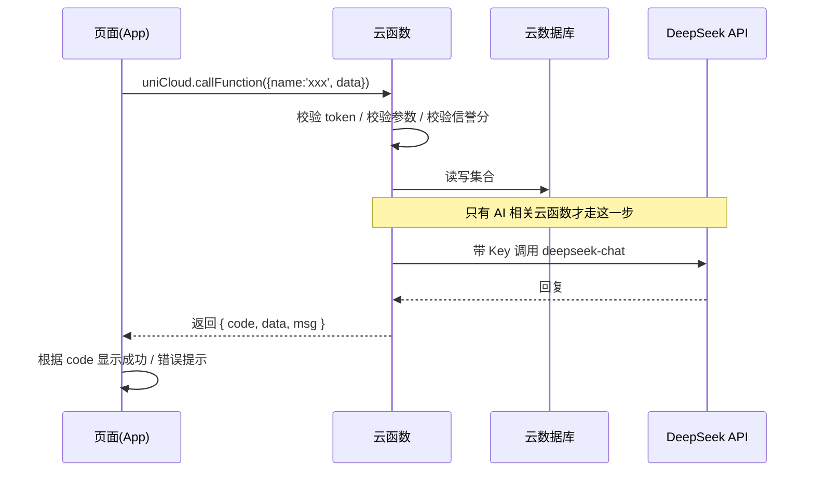

# 04 · 技术选型与成本（uni-app + uniCloud 版）

> v0.4（2026-10-17）：新增 **§8 UI 重设计时必须保留的视觉元素清单**（用户明确要求保留「图片暗底硬边框」）。
> v0.3（2026-10-16）：云服务商由阿里云改为**支付宝云**。原因：DCloud 官方公告，阿里云服务空间自 2026-11-01 起不再支持新建，2027-09-30 正式停服。支付宝云是当前唯一"免费 + 可新建"的选项。
> v0.2（2026-10-16）：技术栈改为 uni-app（Vue3）+ uniCloud（免费版），出安卓 APK。
> 你的底子：C/C++、Python（快过完一遍）、Web、MySQL；Git 装了没用过；Windows 16G；不会 Docker。
> 结论先行：**uni-app（Vue3）+ uniCloud（云函数 / 云数据库 / 云存储）+ DeepSeek API（只在云函数里调）**，用 HBuilderX 云打包出安卓 APK，不上架、不备案、不买服务器。

---

## 1. 选型要满足的硬条件

| 条件 | 为什么 |
|---|---|
| 一套代码出 Android App，且能在真机上秒看效果 | 你只有安卓手机，33 天里"改一行、看一眼"的次数会非常多，预览越快越省时间 |
| 后端要自带（登录 / 数据库 / 存储 / 推送） | 你是初学者，自己搭服务器 + 域名 + HTTPS + 鉴权，至少吃掉 3–5 天 |
| 服务端能安全调用 DeepSeek API | **Key 绝不能放客户端**（APK 能被反编译） |
| 不依赖备案、不依赖上架 | 备案 1–3 周，会直接吃掉交付时间；答辩装 APK 即可 |
| 中文资料多，AI 能帮你排错 | 你的代码 100% 由 AI 生成，语料越多的技术栈，AI 出错越少、你排错越快 |
| 免费额度够演示 | 你没预算（0–50 元） |

---

## 2. 为什么选 uni-app + uniCloud（5 条理由，答辩也能这么说）

1. **环境最好装**：装一个 HBuilderX 就齐了（编辑器 + 运行 + 打包 + 云服务控制台都在里面）。不用装 Android SDK、Java、Gradle，也不用配国内镜像——这些是新手第一天最容易卡死的地方。
2. **真机预览最快**：手机装个"HBuilderX 标准基座"，**扫一下二维码**就能在自己手机上看效果。改代码 → 保存 → 手机自动刷新。这一条直接决定你 33 天的迭代速度。
3. **Vue 的中文语料最多**：AI 写 Vue 代码的准确率很高，报错也基本能搜到中文答案。你用 Python/Web 的底子，看得懂 Vue 的模板语法。
4. **uniCloud 是全中文托管**：云函数、云数据库、云存储、uni-push 推送、前端网页托管，全在一个后台里点。**0 服务器、0 域名、0 备案**，也基本不用写"运维"相关的代码。
5. **它本来就是跨端的**：以后想加个微信小程序版，同一套代码能编译过去（本期不做，但不用重写，这是白送的可能性）。

### 2.1 代价（要提前知道，不要装作没有）

1. **实时聊天没有现成的 WebSocket 服务**：uniCloud 不带"开箱即用"的实时订阅。本期的做法是**消息表 + 3 秒轮询**（见 [06-chat-transport.md](./06-chat-transport.md)），并且预留了"换传输层"的接口——将来要换 WebSocket，只新增一个文件、改一处工厂返回，页面和数据层不动。
2. **它写的是"小程序式"的 Vue**：不能用 `div` / `span`，要用 `view` / `text`；尺寸用 `rpx`；没有 DOM、没有 `window`。AI 经常按 Web Vue 的习惯写错，这是本项目最高频的坑（见 [05 文档 §6 风险表](./05-plan-and-ai-workflow.md)）。

> **为什么这个代价可以接受**：3 秒轮询在"一对一聊天、几十个人内测"的量级下，体验差别几乎感觉不到（对方发来 3 秒内出现），但对你的工期差别是好几天的。**33 天里，先做完 > 做得漂亮。**

---

## 3. 最终栈明细

| 层 | 选择 | 说明 |
|---|---|---|
| 客户端 | uni-app（Vue3 语法）+ HBuilderX | 只做 Android；竖屏锁定；用 HBuilderX「发行 → App 云打包」出 APK |
| UI 组件库 | **uni-ui**（先它，官方、最稳） | 备选 uview-plus。**二选一，不要混用**，混用会出现样式冲突和体积膨胀 |
| 状态管理 | Pinia | uni-app + Vue3 的官方推荐；只放"跨页面要共享的东西"（登录用户、未读数） |
| 路由 / 页面 | `pages.json` 配置式路由 + tabBar | 不用手写路由表；跳转用 `uni.navigateTo` / `uni.switchTab` |
| 网络 | 封装 `uni.request` | 一个 `request.js` 统一加 token、统一超时、统一错误提示；**页面里不直接写 uni.request** |
| 本地存储 | `uni.setStorageSync` / `uni.getStorageSync` | MVP 只存 token 与少量缓存（如上次选的学校） |
| 图片 | `uni.chooseImage` + 上传到云存储 | 上传前先压缩到 ≤ 500KB（`uni.compressImage`） |
| 通知 / 提醒 | 前端定时器 + `uni-push`（离线提醒） | 番茄钟、健身提醒先用页面内定时器；App 不在前台时靠 uni-push 提醒 |
| 原生通知（P1） | `plus.push` 本地通知 | 会用到 5+ 原生 API，风险高、耗时间，**P1 再做**，MVP 不做 |
| 后端 | uniCloud **云函数**（Node.js） | 所有写操作、校验、鉴权、调 AI，都在云函数里 |
| 数据库 | uniCloud **云数据库**（文档型，基于 MongoDB） | 集合 = 原来的"表"；结构见 [03-database.md](./03-database.md) |
| 文件存储 | uniCloud **云存储** | 分目录：`avatar/` 公开、`verify/` 私有、`chat/` 私有、`material/` 待审 |
| 推送 | uniCloud **uni-push** | 离线时提醒"有新消息"；不保证实时，只保证"会提醒" |
| AI | DeepSeek API（`deepseek-chat`） | **只在云函数里调用**；Key 放云函数的环境变量 |
| 管理后台 | MVP：**uniCloud web 控制台**（0 开发）；有余力再写 1 个单页审核页 | 控制台能看集合、改状态、看云存储里的图片；审核学生证够用 |
| 版本控制 | Git + GitHub 私有仓库 | 每天至少 1 次提交；`.gitignore` 排除 uniCloud 私有配置与密钥 |
| 部署 | HBuilderX 云打包出 APK，直接发给评委 / 同学 | 不上架、不备案、零成本 |

### 3.1 一个请求在你项目里是怎么走的（看懂这张图，就不会写错代码）

> 关键点：**页面永远不直连数据库、永远不接触 Key**。页面只认识"云函数名 + 入参 + 返回格式"，这样以后换数据库、换模型，页面都不用改。

### 3.2 为什么不用 Docker

你问过它是什么，一句话——**Docker 是把"代码 + 运行环境"打包成一个盒子，换台机器也能一样跑**。

你这一版**不需要它**，原因很直接：uniCloud 是**托管服务**，服务器、运行环境、数据库都在云端由平台维护，你本地只需要 HBuilderX（它内置 Node 环境来跑 uni-app 项目）。你手上没有任何"需要自己部署的服务"，所以没有需要用盒子装的运行环境。

> 什么时候才需要看它：以后你自己租一台服务器、自己部署后端服务时，Docker 才真正有用（那时候你至少要操心 HTTPS、进程守护、重启、日志）。**本期不学，把时间留给主链。**

---

## 4. 成本估算

| 项 | 额度 / 价格 | 你的场景够不够 |
|---|---|---|
| uniCloud **支付宝云免费版**服务空间 | 具体额度**以官网为准**（免费版有云函数调用、数据库容量、存储与流量上限） | 演示 + 小规模内测**够用**；要盯住"聊天轮询带来的云函数调用量"（见 05 文档风险表） |
| DeepSeek API | 按 token 计费，很便宜；**建议充 20–50 元并设每日上限** | 云函数里做"每用户每日 20 条 + 全局每日总额度"双上限，防止被刷 |
| 域名 / 服务器 | **0 元** | uniCloud 自带公网入口，不需要自己的域名和服务器 |
| 短信验证码 | 0 元（用"手机号 + 密码"即可免掉） | 若要做真实短信验证码，需要实名服务商，本期不做 |
| 上架应用商店 | **0 元**（本期不上架） | 答辩现场装 APK |
| 开发工具 | HBuilderX、DCloud 账号、Git 全部免费 | — |

**总计：0–50 元。**（真正贵的不是钱，是你 33 天的时间和"环境装不上"的风险。）

---

## 5. 安全红线（这几条答辩和上线都会被问，逐条都能说清"为什么"）

1. **DeepSeek API Key 只写在云函数的环境变量里**。客户端任何地方都不能出现 Key（APK 能反编译，写进去等于公开）。同理，**不要把 Key 贴进任何 AI 对话，也不要提交进 Git**。uniCloud 的 `spaceId`、云函数名这类**非密钥信息**可以贴给 AI 帮你排错。
2. **密码只存加盐哈希**（如 bcrypt / 加盐 SHA256），`users` 集合里永远不出现明文密码；客户端只存 token。
3. **学生证图片放私有目录**（云存储里区分公开 / 私有），只有本人和管理员能看；审核通过后可定期清理原图，只保留审核结论。
4. **用云数据库的 DB Schema 权限控制"谁能读写哪几行"**（`read` / `create` / `update` / `delete` 四个表达式 + `bsonType` / `required` 校验）。默认原则：**写操作一律 `false`，只让云函数写**；客户端只读公开数据。Schema 挡不住"按行过滤"，所以**越权校验必须在云函数里再做一遍**。
5. **上传文件校验类型与大小**：图片 ≤ 5MB、资料 ≤ 20MB；文件名重命名（用时间戳 + 随机串），防止覆盖与路径穿越。
6. **管理后台不要裸奔**：MVP 用 uniCloud web 控制台（需要登录你的 DCloud 账号才能进），不要把审核能力做成一个谁都能打开的网页。
7. **隐私合规四件套**：隐私政策页、用户协议页、举报入口、账号注销，四个都要有。

---

## 6. 你需要装什么（第 1 天清单）

| 工具 | 用途 | 备注 |
|---|---|---|
| **HBuilderX（App 开发版）** | 写代码 + 运行 + 云打包，一站式 | 官网下载，选 **App 开发版**（不是标准版），否则打包和真机调试会缺功能 |
| **DCloud 账号**（免费注册） | 登录 HBuilderX、云打包、uniCloud 控制台 | 用手机号注册，免费 |
| **uniCloud 支付宝云免费服务空间** | 云函数 / 云数据库 / 云存储 / uni-push | 在 HBuilderX 里右键 `uniCloud-alipay` → 关联云服务空间；额度**以官网为准**。注意：需 DCloud 实名主体与支付宝账号主体一致 |
| **Git for Windows** | 版本控制 | 装完配 `user.name` / `user.email` |
| **一个 GitHub 账号** | 私有远程仓库 | 每天提交一次，代码丢了才救得回来 |
| 安卓手机 + 数据线（或同一 WiFi） | 真机运行 | 扫码或 USB 连接都能跑；两种方式都试一下，哪个通用哪个 |
| DeepSeek 开放平台账号 | AI 机器人 | **充值 20–50 元**，拿到 Key（**只填到云函数环境变量里**） |

> 不需要装：Android Studio、Flutter SDK、Java、Gradle、Node.js（HBuilderX 自带）、Docker。**少装一个东西，就少一个第一天会卡住你的地方。**

---

## 7. 决策记录：为什么没用 Flutter + Supabase

> 这一节是**留档**，说明我们比较过、而且是因为什么放弃的。以后别人（或答辩老师）问"为什么不用更流行的方案"，照这段答。

原本的备选方案是 **Flutter（Android 客户端）+ Supabase（登录 / 数据库 / 存储 / 实时消息）**。它的优点是真实存在的：

- **实时聊天开箱即用**：Supabase Realtime 底层就是 WebSocket，订阅一下就能收到新消息，"消息表 + 实时推送"这条链路不用自己写。
- **后端能力齐**：登录、Postgres 数据库、对象存储、行级安全（RLS）都有，管理界面也很好用。

放弃它，是因为下面这几条在**你这个具体条件下**（一个人、33 天、安卓、无预算、代码全靠 AI、零运维经验）代价太高：

| 放弃的理由 | 具体是卡在哪 |
|---|---|
| **首日环境门槛高** | Flutter 要装 Flutter SDK + Android SDK + Java(JDK) + Gradle，还要配国内镜像，`flutter doctor` 常常一排红叉。装环境本身就可能吃掉 1–2 天 |
| **Dart 语料比 Vue 少** | 你的代码由 AI 生成，AI 在 Dart/Flutter 上的样例明显少于 Vue，报错也更难用中文搜到解法 |
| **国内访问 `supabase.co` 未验证** | 服务在境外，校园网 / 4G 下的连通性和速度没有实测保障。一旦答辩现场不稳，风险无法兜底 |
| **免费版会休眠** | 免费版项目长期无请求会暂停，演示当天第一次打开可能很慢甚至失败——这是"演示会翻车"级别的风险 |
| **大陆自建后端要备案** | 如果为了速度换成"国内服务器 + 自己的后端"，80/443 端口就需要 ICP 备案（1–3 周），直接吃掉工期 |
| **多一套技术要学** | 你还要同时学 Dart、Flutter 布局、Supabase 的 RLS —— 33 天里，每多学一样都在压缩做主链的时间 |

**换到 uni-app + uniCloud 后，这些代价变成了什么**：

| 原来的问题 | 现在的状态 |
|---|---|
| 环境门槛高 | 装 HBuilderX 一个包，扫码就能真机预览 |
| 语料少、AI 排错慢 | Vue 中文语料最多 |
| 境外服务连通性未验证 | uniCloud 走国内云，无需自己验证境外连通性 |
| 免费版休眠 | 支付宝云免费服务空间，**具体行为以官网为准**；演示前记得"预热"一次 |
| 云厂商单点风险 | 已在选型阶段规避：阿里云线 2027-09-30 停服，故选支付宝云；云函数代码本身是标准 Node.js + uniCloud API，真要迁移只改服务空间关联，业务代码不动 |
| 要备案 | 不需要域名和服务器，**0 备案** |
| 实时聊天开箱即用 ✅ | **这是唯一真正失去的东西**：改成了 3 秒轮询，但预留了可替换的传输层接口（见 [06-chat-transport.md](./06-chat-transport.md)），P1 能换回 WebSocket |

> 一句话总结：**我们用"聊天不是真·实时（3 秒内到达）"换来了"环境能装、资料能查、不备案、不翻墙、能按时做完"。** 对本项目来说这笔交易划算。

---

## 8. UI 重设计时必须保留的视觉元素清单

> 当前视觉是新粗野主义（Neo-Brutalism）皮肤，用户已明确"视觉暂用，以后再换"。换皮时**下面这些元素要保留**——它们是用户点名认可的，不是皮肤的一部分，是产品语言的一部分。

| # | 元素 | 当前实现 | 为什么保留 |
|---|---|---|---|
| 1 | **图片暗底硬边框** | `chat.vue` `.bubble-img`：`border: 3rpx solid var(--tf-text)` + `box-shadow: 4rpx 4rpx 0 var(--tf-text)` | **用户点名要求保留**（2026-10-17）。用户原话：「这个框周围有暗底框的样式很能给图片加视觉效果」。图片本身颜色不可控，加一圈深色描边 + 无模糊的偏移阴影，能把它从背景里"提"出来，任何配色方案下都成立 |
| 2 | 搭子标签的闪亮反光 | `shine-*` 8 个预设色 + 高光渐变 + 悬停扫光 | 用户在原型阶段反复调过，是"搭子"这个概念的可视化载体 |
| 3 | 底部导航中间凸起的「＋」 | 5 列布局，中间栏凸出栏外 | 抖音式，用户已确认 |

**换皮的边界**：颜色、字体、圆角、间距、阴影偏移量都可以改；**「图片要有深色描边 + 硬阴影」这条要留着**——换成柔和阴影也行，但别变成无边框的裸图。

> 如果将来真的要去掉这些元素，先问用户，不要自己判断"反正要换皮了"就连着一起删。

