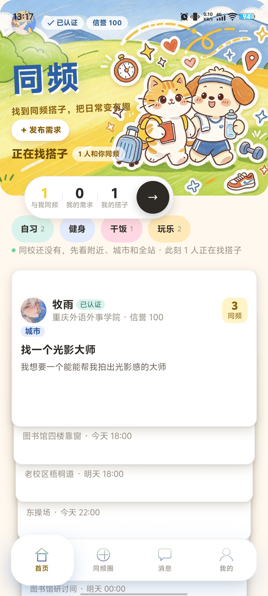
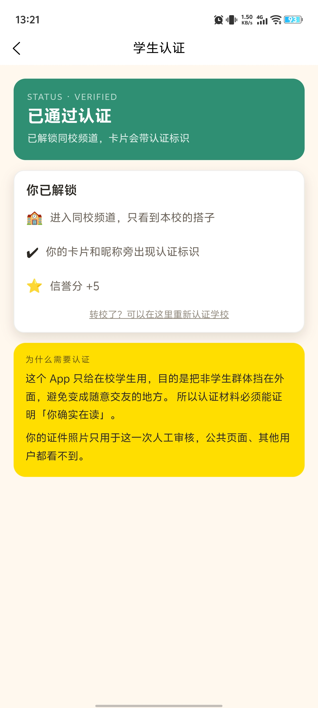
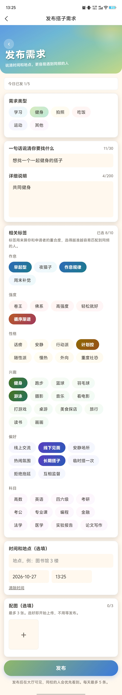
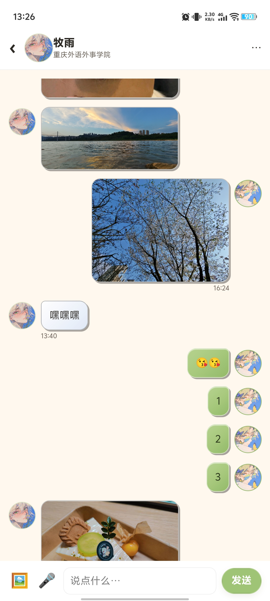
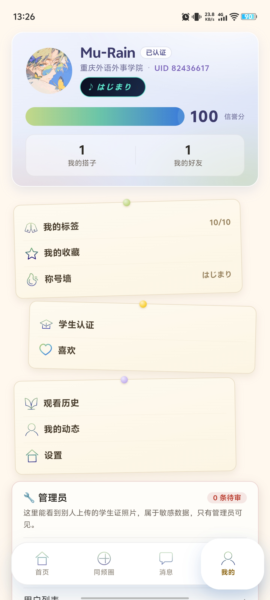
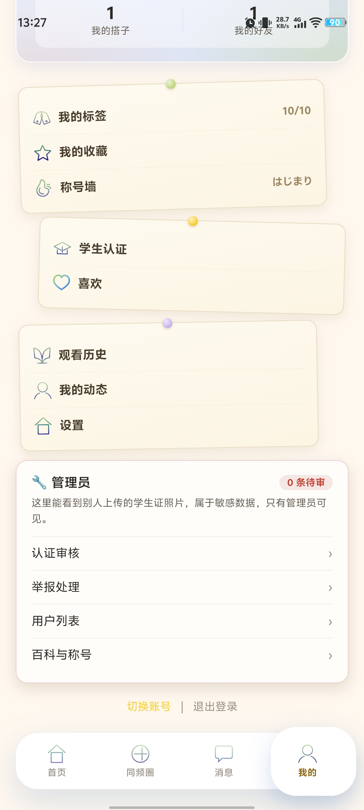

# 同频 · 校园搭子 App —— 作品介绍文档

## 封面

| 项目 | 内容 |
| --- | --- |
| 作品名称 | 同频 · 校园搭子 App |
| 参赛赛事 | 传智杯 · AI 创新应用挑战赛 |
| 参赛形式 | 个人赛（独立完成全部设计与开发） |
| 学校/单位 | 重庆外语外事学院 |
| 参赛者 | 张瑜 |
| 指导老师 | 封明杰　17802582393 |
| 联系方式 | 19122926171 |


---

## 设计初衷

这个软件想解决的不是一个功能缺口，而是一件我反复看到的、很小的事。

校园里最常见的一句需求是「这事我想做，但缺个人」：周六晚上想去南湖操场打球还差两个、想拍一组秋天的照片但没人按快门、期末想找人一起泡图书馆互相盯着。这类需求有三个共同点——**时效短**（过了那个晚上就作废）、**半径小**（同校或十公里内才有意义）、**需要筛选**（不想和谁都约）。可现有渠道没一个对得上：班级群和年级群是信息洪流，一条需求两分钟就被刷走；超话和贴吧没有身份门槛，约出来的人根本不认识；而在熟人社交网络里发「求搭子」又有社交成本——等于当众承认自己一个人。结果是**大量本来能成行的低成本活动，根本没有发生**。

所以我把问题重新描述了一遍：不是「怎么让更多人看到这条需求」，而是「怎么让这条需求在一个对的半径内、被一个可信的人看见，并且能当场定下来」。这一步想清楚之后，后面三个设计判断基本是被推出来的，不是拍脑袋：

1. **做成结构化卡片，而不是信息流。** 信息流靠刷新，需求靠状态。类别、时间、地点、人数、信誉分各占一个字段，才可能被筛选、被匹配、被「约成」。这是我从一开始就拒绝把首页做成动态流的原因——动态流解决曝光，卡片解决成行。
2. **用学生认证回答「靠不靠谱」，而不是靠自我介绍。** 校园结伴的瓶颈不在曝光，在可信。所以认证不是一个装饰徽章，它是同校频道的开关：服务端在分档时让未认证用户完全不参与同校档判定，改一个 school_id 也看不了那所学校。认证带来的约束越硬，用它的人越敢约。
3. **把「同校」放在第一档，而不是全城铺开。** 同城范围一大，标签就没有信息量；同校才让「南湖操场」「三食堂」这类地点自带含义。档位是 同校 → 附近 → 城市 的渐进降级，而不是给一张全国大表让人自己筛。

还有一层是现实约束下的取舍。这是一个个人赛作品，我一个人做完前端、84 个云函数、数据库与审核后台。选 uni-app 加 uniCloud，是因为它让「一个人」也能同时把客户端、服务端、存储和推送做完，不需要买服务器、不需要备案、不需要运维；代价是我必须自己补上工程纪律（全量语法自检、逐接口契约文档、99 条真机回归清单），否则单人项目最容易死在「改一处、坏三处」上。

一句话概括初衷：**让校园里那些「就差一个人」的小事，能以最低的社交成本发生。**

---

## （1）描述项目详情及使用方式

### 定位

我做的是一款面向在校大学生的校园搭子应用，要解决的不是「多认识几个人」，而是「今天下午四点想去打球，现在缺一个人」这类短时、具体的结伴需求。这种需求在群聊里两条消息就被刷走，所以我把它做成结构化卡片（类别、时间、地点、人数、信誉分），再用学生认证回答「这个人靠不靠谱」。我从一开始就判断：校园结伴的瓶颈不在曝光，而在可信。

### 目标用户

我把目标用户定在 18 至 24 岁在校本科生，住校或在校区周边活动。空间上我让同校优先，其次 10 公里内的「附近」，最后同城——再大整座城市都算附近，标签就没有信息量（`app/uniCloud-alipay/cloudfunctions/card-list/index.js:91-99`）。典型场景是约球、约饭、约自习、约拍照、约比赛。

### 四个 tab

| tab | 页面 | 我让它承担的功能 |
| --- | --- | --- |
| 首页 | `app/pages/index/index.vue`（1661 行） | 找搭子的主入口，卡片按同校→附近→城市自动分档，每条带档位与距离，顶部放认证与信誉标识 |
| 同频圈 | `app/pages/feed/feed.vue`（1468 行） | 校园日常动态流，我把频道拆成三档：同校 / 地区 / 发现（`feed.vue:221-224`） |
| 消息 | `app/pages/messages/messages.vue` | 会话列表与搭子关系，带本地快照，冷启动首帧就有内容 |
| 我的 | `app/pages/mine/mine.vue`（1705 行） | 资料、认证状态、我的搭子 / 喜欢 / 推荐 / 观看历史，以及后台审核入口 |

### 完整使用路径（可照着操作）

下面是我自己走一遍的完整路径，可以照着点：

1. 启动。我让页面先读本地登录态：已登录直接进首页，未登录也能先浏览全站档，点头像才进登录页。
2. 注册。填昵称、手机号、中文校名，注册即写入登录态，此时账号还未认证。
3. 学生认证。进 `app/pages/verify/verify.vue`（860 行），填真实姓名、学号，选学校，上传学生证照片。人工审核 1 至 2 个工作日，最多提交 3 次（`verify.vue:241-242`）。通过后解锁同校频道、卡片带认证标识、信誉 +5。
4. 发需求。回首页点「＋ 发布需求」，填标题、类别、时间、地点、人数与说明，提交生成需求卡。未认证账号我只给一张引导卡，不显示表单。
5. 发动态（可选）。进同频圈发布动态，我把每天上限压在 20 条（`app/pages/post/post.vue:44`）。
6. 匹配。点开卡片详情，点「同频一下」发出申请；对方在消息里接受，建立搭子关系并同时建立会话。
7. 聊天。进 `app/pages/chat/chat.vue`（3703 行），文字、语音、图片、动态分享卡四类消息都能发；图片上传前我先压到长边 1280、质量 60。
8. 约局确认。会话里发起约局，对方收到结构化卡片（`type: 'structured'`），确认后落定时间地点，结束后可互评累积信誉。

演示账号（评委可直接登录）：

| 手机号 | 密码 | 昵称 | UID | 信誉分 | 这个号里有什么 |
| --- | --- | --- | --- | --- | --- |
| 13800000001 | Aa123456 | 林小满 | 10000001 | 92 | 主演示号：1 条自己发的需求、与周叙的进行中搭子关系、8 条信誉流水、2 个已获得称号（佩戴「初次搭成」） |
| 13800000002 | Aa123456 | 周叙 | 10000002 | 88 | 2 条需求，是林小满的搭子对方，用来演示双边确认与会话 |
| 13800000003 | Aa123456 | 陈默 | 10000003 | 76 | 2 条需求，用来演示「不同人、不同标签」下的同频匹配差异 |

三个账号均已通过学生认证（同一所学校与城市），登录后可以直接进「同校」频道，不需要评委再做认证流程。它们由 `demo-seed` 云函数生成：固定 UID（10000001–10000003）便于按号搜人，数据行带 `seed: 'demo-seed'` 标记，脚本可重复执行、只清理自己造的数据，不会动真实用户。

首次部署后需要在云控制台运行一次 `demo-seed`（幂等，重跑会重置为上述状态）。

---

## （2）描述项目的亮点

**亮点 1｜我坚持让学生认证成为「同校频道」的开关，而不是一枚装饰徽章。**
机制：服务端给候选卡片分档时，未认证用户完全不参与同校档判定，否则改一个 school_id 就能看遍那所学校。我没有把这条路做成「报错拦住」，而是返回空列表加 `degraded='need_verify'`，前端据此给认证引导而不是转圈——被拦下的人应当知道下一步该干什么。
证据：`card-list/index.js:20`、`:169-177`；`app/pages/verify/verify.vue:242`。

**亮点 2｜同频圈三档频道，我要求切档时请求既不丢也不串。**
机制：三档映射到 post-list 的三个筛选口径，切换只改 scope。每次拉取我让页面自增序号，回包序号对不上就整包丢弃；脏标记记下「在飞时又被催过」，收尾补发一发；loading 复位我固定在 finally 里，免得异常分支把页面卡在转圈。
证据：`app/pages/feed/feed.vue:221-224`、`:275-278`、`:581-596`、`:618`、`:644-647`。

**亮点 3｜聊天首帧就贴底，而且分得清「自己在滚」和「用户接管」。**
机制：进页面我把底部锚点 id 直接给 scroll-into-view，第一帧就渲染在底部，不依赖先渲染再滚；定位完成后必须先清空再设值，因为这个属性只在值变化时触发滚动。用户上翻离开底部超过 40 像素我就关闭自动跟随，此后图片撑高也不会把人拽回底部。
证据：`app/pages/chat/chat.vue:302`、`:506-523`、`:2266-2289`、`:2347-2348`。

**亮点 4｜图片气泡的宽高是契约，我不等图下载完就定好。**
机制：气泡高度只能由真实宽高比算出，等下载完再撑高，用户会先看到一个占位高度再被顶下去。所以发送前我在本地量出压缩图的像素宽高，随消息一起提交，渲染侧直接定盒：超过 640rpx 的长图先封高、宽度按比例收窄，图片本身用 aspectFit 整张显示永不被裁；尺寸未知时先放一个不可见探针把比例量出来。
证据：`chat.vue:182-205`、`:414`、`:2466-2480`、`:2495-2502`、`:2181`。

**亮点 5｜头像走落盘缓存加显式淡入，不再每次换链重下。**
机制：fileID 必须先换临时链接才能渲染，一次往返几百毫秒到一秒。我做了两级缓存：链接写本地存储带 100 分钟过期，文件用 saveFile 落盘后以本地路径渲染，命中时一个字节都不走网络。淡入只靠 key 级 ready 标记驱动 opacity，地址没变就直接返回、绝不把 ready 打回 false——否则图不重新解码、不再派 @load，节点会永远停在不透明外。
证据：`app/common/avatar/avatarCache.js:444-496`、`:533-543`、`:520-524`、`:547`；`app/common/chat/imageCache.js:16-20`；五个页面共用同一时序（`chat.vue:464`、`feed.vue:247`、`index.vue:258`、`messages.vue:329`、`mine.vue:233`）。

**亮点 6｜换校审核期间我不摘已有徽章，不把老用户锁回门外。**
机制：常规做法一提交换校就把认证态清成审核中，用户立刻被踢出同校频道，可他确实还是在校学生。所以换校我走独立分支：单独计配额、不清 is_verified，审核期间显示 pending 但徽章与同校权限保留，通过后只更新 school_id 与校名。
证据：`verify-submit/index.js:25`、`:38-39`；`verify-review/index.js:481`；`app/pages/verify/verify.vue:27-36`。

**亮点 7｜切 tab 的首帧与网络请求解耦。**
机制：onShow 与首次渲染在同一个同步任务里，直接发请求会把 uniCloud 桥初始化、请求构造、storage 读全挤进首帧那一帧。我的做法是让出当前帧：有快照或已有数据时用 nextTick 加 30 毫秒，完全没有数据时用 0 毫秒——0 毫秒不等于同步发，它仍是宏任务，首帧会先提交。四个 tab 页共用这套写法，另配 60 秒节流键。
证据：`app/pages/feed/feed.vue:396-405`、`:435-441`；`app/pages/messages/messages.vue:406-420`；`app/pages/index/index.vue:622`。

---

## （3）AI测试技术落地使用情况概述

我只写自己真实跑过的四类链路。

### a) 全量静态自检：44 个 .vue 抽 script 加 13 个 .js 一起过 node --check

.vue 不是合法 JavaScript，任何校验工具都直接解析不了，而只改一行样式就整包编译一次的代价我付不起。所以我把每个 .vue 的 `<script>` 块抽成独立 .mjs 再逐个检查，换来一个秒级回答「这批页面有没有语法错误」的入口。本轮实测（遍历 `app/` 下全部 .vue 抽 script 写临时 .mjs 后逐个 `node --check`，再对全部非 uniCloud 的 .js 跑同样检查）：

```
{"vueTotal":44,"vuePass":44,"vueFail":[],"jsTotal":13,"jsPass":13,"jsFail":[]}
```

即 57 个文件、0 失败。

### b) 桩化单元测试：avatarCache 模块 17 条断言加 mixin 时序 22 条断言

头像链路与首帧时序都是「只在真机暴露、一暴露就是全页面级」的问题，人眼点不出来，所以我在 Node 里用 uni 桩跑。桩覆盖的真实故障场景包括：downloadFile 永不回调、同一 fileID 重新换出签名不同的链接、本地文件被系统清理、并发两次请求同一 key、落盘失败只能退回原始地址。

avatarCache 模块级 17 条断言覆盖换链失败、落盘失败、TTL 过期淘汰、索引超量裁剪、清空缓存与缓存计数；mixin 时序 22 条断言覆盖「地址没变不重置 ready」「3 秒兜底挂原地址」「1.5 秒无条件放出」「换图先退回透明再淡入」「同一条数据不重复解析」「解绑后迟到的回包被丢弃」。这两组断言在「头像过一会儿全变空圆」那次修复里帮我定位了问题，修完我又补了 12 条场景断言（同 fileID 换出不同签名链接、本地文件被清理、并发同 key、落盘失败退回原地址）与 3 条兜底断言。价值不在数量而在可重跑：改完头像链路必须重跑，否则五页的淡入时序会各飘一点。

### c) 契约文档驱动：前后端按同一份文件改

`docs/30-后端交接.md`（1171 行）是我的核心工作物。它不是接口清单，而是逐接口写清入参变化、出参变化、前端现状、上线清单的施工图：哪些是全量口径哪些是分档口径、哪几个需要重新上传、顺序是什么。前端按同一份契约改渲染，后端按同一份改返回。同类还有 `docs/16-聊天增强契约.md`、`docs/19-M3信誉系统契约.md`。

### d) 真机回归清单：15 个分节、99 条可勾条目

`docs/35-上线前真机回归清单.md` 共 222 行，分 15 节，99 条 `- [ ]` 条目。每一条我都写成「怎么点加应该看到什么」，开头先列四条前置确认（云函数已上传、集合齐全、静态图非 0 字节、版本号与基座模块），任何一条不成立后面全白跑，正常路径约 25 分钟跑完。

### e) 我让 AI 承担什么、我自己把关什么

AI 帮我做四件事：定位根因（例如把「头像过一会儿全变空圆」倒推到 ready 被误复位、之后再无 @load）、写补丁、跑自检（静态检查与桩化断言，改完即重跑）、写文档（把结论落成契约与回归清单）。这四件事我愿意交出去，是因为它们都有明确的验收口子：检查能跑、补丁能回滚、文档能对着代码核。

但有两件事我不交给它。一是真机验收——相机权限、录音、落盘、弱网、机型差异，桩测不出来，只能我拿着清单逐条过；二是产品取舍——附近取 10 公里还是 20 公里、长图封高取 640rpx 还是更高，AI 能给出方案，但不该替我决定。

## （4）描述项目中涉及的关键技术

**1. Vue 3 选项式 API 与 uni-app 跨端**
是什么：uni-app 用一套代码编译到多端，选项式写法用 data / methods / 生命周期组织页面（`manifest.json:99` 声明 `vueVersion: 3`，`main.js` 用 createSSRApp 作入口）。
我怎么用：44 个 .vue 组件全部写成选项式，不用 `<script setup>`，跨端差异集中收在少数几个函数里。
我为什么这么选：页面多、人手只有我一个，选项式的阅读路径最短——找一个方法不用先把 setup 里的闭包读完。

**2. 支付宝 uniCloud 云函数、云数据库与云存储**
是什么：支付宝生态的一体化 Serverless，云函数是 Node 入口函数，云数据库是类 MongoDB 的集合操作，云存储存文件并给 cloud:// 的 fileID。
我怎么用：84 个云函数按业务域拆开（card-* 需求卡、message-* 聊天、buddy-* 搭子关系、verify-* 认证、admin-* 后台），每个函数头部写清入参、出参与错误码；图片走 `uniCloud.uploadFile` 客户端直传，不经函数中转。
我为什么这么选：没有运维预算，Serverless 把部署、扩容、鉴权都收掉；按函数拆分是因为调用量差异极大，冷启动与超时能分开调。

**3. 临时链接换链与落盘缓存的两级图片缓存**
是什么：fileID 不能直接当图片地址，要调 `uniCloud.getTempFileURL` 换成带签名的临时链接，约 2 小时过期。
我怎么用：第一级缓存链接（本地存储、TTL 100 分钟、上限 300 条），第二级缓存文件（saveFile 落盘后以本地路径渲染，上限 120 个、并发 3），两级都未命中才走网络。
我为什么这么选：单级缓存解决不了「切回来又慢一次」——链接缓存省换链，文件缓存省下载；TTL 取 100 分钟是为了避开临界过期。

**4. 3 秒轮询长连接替身与 3→6→12→24→30 秒退避**
是什么：用定时拉取代替 WebSocket，作为消息实时性的最小实现。
我怎么用：活跃 3 秒一轮，静默超阈值降到 10 秒；出错从 3000 毫秒起翻倍、封顶 30000 毫秒，成功一次立刻复位。
证据：`app/common/chat/transport.js:26`、`:28`、`:32-33`、`:169`、`:193`。
我为什么这么选：小程序端长连接在切后台、弱网下易断且重连不可控，轮询的失败模式可预期；退避既不把配额打爆，又能在恢复后 30 秒内重连。

**5. 游标分页与 limit+1 判 has_more**
是什么：不用页码偏移，用上一页最后一条的 id 或时间作游标，并多取一条判断有无更多。
我怎么用：聊天历史以 `beforeMessageId` 为游标取 30 条、多取一条判 `has_more_before`，回包反转为升序；时间比较用 `<=` 并排除锚点自身 id，避免同毫秒消息丢条。
证据：`app/uniCloud-alipay/cloudfunctions/message-list/index.js:218-260`；`app/pages/feed/feed.vue:618`。
我为什么这么选：页码偏移在边发边看的场景必然错位；limit+1 比额外一次 count 便宜，而且 count 本身也不准。

**6. 请求序号作废过期响应**
是什么：每次请求前自增序号，回包比对，不是最新就整包丢弃。
我怎么用：同频圈切档、首页刷新、会话列表刷新都走这套，一页一个 loadSeq，回包先判 `mySeq !== this.loadSeq` 直接 return。
证据：`app/pages/feed/feed.vue:581-596`、`:638`。
我为什么这么选：连点三档时三个请求并发在飞，网络乱序会让后发先回；没有序号只能靠「最后一个成功的赢」，弱网下等于随机。

**7. 数据窗口裁剪**
是什么：给内存里的消息列表设硬上界，超出就从最旧一端批量裁掉。
我怎么用：贴底且条数超过 200 时一次裁掉 80 条，避免每条新消息都触发裁剪；裁掉的较早消息仍可上拉重拉。
证据：`app/pages/chat/chat.vue:430-432`（MAX_KEEP = 200、TRIM_BATCH = 80）、`:885-892`、`:1539-1540`。
我为什么这么选：小程序对节点数与内存有硬上限，长会话不裁剪会崩；批量裁剪把一次重排开销摊到 80 条消息上。

**8. CSS 变量主题系统与液态玻璃**
是什么：颜色、字号、圆角、阴影、间距收敛成一份 token，同时以 SCSS 变量与 CSS 变量暴露，值完全一致。
我怎么用：`app/styles/tokens.scss`（43 行）是唯一真源，主色 #ff6b35、AI 身份色 #ffd84d、五档字号、五档间距；现有页面沿用 `var(--tf-*)` 旧名（全站 1049 处引用），值由 App.vue 的 page 选择器注入；玻璃用 `var(--tf-glass-blur)` 统一模糊半径，全站 114 处 backdrop-filter 共用同一套参数。
证据：`app/styles/tokens.scss:8-12`；`app/pages/chat/chat.vue:3573-3574`。
我为什么这么选：1049 处全量改名收益为零、风险很高，所以旧名只换值；玻璃走单一变量，改一个数字就够。

**9. 自定义 tabBar 与原生 tabBar 共存处理**
是什么：tabBar 可声明 custom: true，此时视觉层由自绘组件替代，但 switchTab 的路由行为仍由框架接管。
我怎么用：`app/pages.json:291-324` 声明 `custom: true` 并保留四个 list 项，自绘组件在 `app/custom-tab-bar/index.vue`（316 行），选中态自维护、跳转仍调 `uni.switchTab`；滑块位置确定前不显示第一帧。
证据：`custom-tab-bar/index.vue:45`（改页面必须同步改 pages.json，否则 switchTab 会跳到不在 tabBar 里的页面而失败）、`:66`、`:89`。
我为什么这么选：原生 tabBar 做不了悬浮发布按钮与玻璃底板，全自绘又要自己管页面栈；保留 list 项让路由归框架，成本最低。

**10. 事务退化策略**
是什么：云数据库事务在部分云厂商或早期版本上不可用——`db.startTransaction` 可能不存在，或开了直接抛错。
我怎么用：多表写入（卡片与标签、接受申请时建关系并关卡片）先尝试开事务，成功提交、失败回滚；只有「事务根本没开起来」才退化为顺序写并打 warn，开起来后失败的按真实错误抛出。
证据：`app/uniCloud-alipay/cloudfunctions/card-update/index.js:195-243`（`:199-202` 写清退化边界，`:220-240` 是提交、回滚与 warn 分支）。
我为什么这么选：退化的目标是能力不足时仍然可用，不是出错时假装成功；把退化限制在开事务失败这一个分支，就不会把数据不一致伪装成正常返回。

---

## （5）项目相关的图片/照片

我把十张图放进 docs/images/，按下列文件名命名。

| 文件名建议 | 截图要点 | 对应功能 |
| --- | --- | --- |
| 01-splash.png | 启动页整屏，品牌字与主视觉完整，状态栏不压标题 | 启动与登录态恢复 |
| 02-home.png | 首页首屏，含认证标识与信誉分、两张需求卡、右上角的「N 同频」徽章 | 智能分档卡片流 |
| 03-feed-school.png | 同频圈「同校」档，三档切换控件可见且选中在同校 | 三档频道之一 |
| 04-feed-city.png | 同频圈「地区」或「发现」档，内容与上一张明显不同 | 三档频道切换 |
| 05-verify.png | 认证表单，含学校选择、姓名、学号、证件上传与隐私说明 | 学生身份认证 |
| 06-publish.png | 发布需求表单填到一半，类别、时间、地点、人数都可见 | 发布搭子需求 |
| 07-match.png | 卡片详情页，含「同频一下」按钮与对方认证标识、信誉分 | 匹配与申请 |
| 08-chat-image.png | 一张图片气泡加一条文字气泡，图片完整不被裁、气泡紧贴边缘 | 图片气泡宽高契约 |
| 09-me.png | 我的页，含头像、认证徽章与四个功能入口 | 个人中心 |
| 10-admin.png | 后台审核列表，含待审核条数与一条展开详情 | 认证人工审核 |
















---

## （6）项目之前是否发表过或获奖

我此前没有发表过这个作品，也没有拿它参加过其他比赛，更没有获过奖。

按赛事要求我如实声明：此前无发表记录，也无获奖记录。

---

## （7）若项目在其他项目基础上优化

这是我独立原创的作品，**不属于**在他人项目或开源模板基础上的二次开发，也不存在更早的项目版本。数据模型（38 个集合）、84 个云函数的入参出参与错误码、页面结构与视觉体系，都是我自己设计与实现的；我只在 uni-app 与支付宝 uniCloud 这两个通用技术栈之上开发，没有引入任何业务脚手架或现成模板。

若评审想知道「哪些地方是我自己的判断」，下面六项是我自行设计的关键决策，可以直接对照代码核查：

1. 认证体系与换校。我把认证做成独立状态机（未提交 / 审核中 / 已通过 / 已驳回），换校走独立分支与独立配额，且审核期间不清 `is_verified` —— 避免转校学生被临时踢出同校频道。
2. 同频圈请求链路。切档我用「请求序号作废过期回包 + 脏标记补发 + `finally` 复位加载态」三件套，修掉「切频道永久转圈」这一类弱网故障。
3. 聊天首帧与滚动。首帧通过底部锚点直接落底，并用 40 像素阈值区分「程序滚动」与「用户接管」，用户上翻后不再被拽回底部。
4. 图片与头像链路。链接缓存与文件缓存两级并存，头像另加落盘与逐条淡入，五个页面共用同一时序；图片地址签名变化时不重复解码。
5. 宽高契约。发送前我在本地量出图片像素宽高并随消息提交，渲染侧直接定盒，避免「等图下载完再撑高」导致的整页跳动。
6. 工程质量。全量静态自检（57 个文件）、桩化单元测试、逐接口契约文档（`docs/30-后端交接.md` 1171 行）与 99 条真机回归条目，让我「改一行 → 验证」的循环可重复。

---

## 演示视频

视频链接：https://www.bilibili.com/video/BV1QZxC6kEkc/（B 站，可直接播放）
